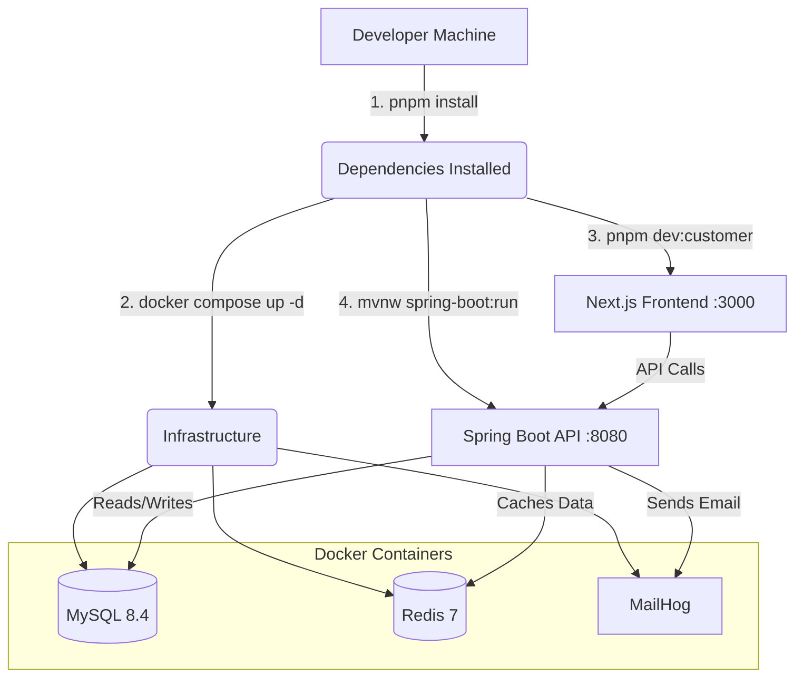

# Tech Stack Setup Guide

Welcome to Archim's TechCorner! This guide will help you set up your local development environment.

## 🛠 Complete Tech Stack

| Domain | Technology | Version Constraint | Key Libraries / Details |
| :--- | :--- | :--- | :--- |
| **Frontend** | Node.js / React | `Node >=20` | Next.js `14.2.15`, React `18.3.1`, Zod, React Hook Form |
| **Backend API** | Java / Spring Boot | (via Maven wrapper) | Modular monolith architecture, Auth module |
| **Package Manager**| pnpm | `9.7.0` | Monorepo structure, workspace management |
| **Database** | MySQL | `8.4` | Managed via Docker, Flyway for migrations |
| **Cache** | Redis | `7-alpine` | Managed via Docker, temporary/accelerator only |
| **Email Testing** | MailHog | `v1.0.1` | Local SMTP capture (Web UI on port `8025`) |

---

## 🚀 Beginner-Friendly Setup Instructions

### Prerequisites (All Platforms)
1. **Git**: Ensure Git is installed and you have cloned the repository.
2. **Node.js**: Install Node.js `20.x` or higher.
3. **pnpm**: Install pnpm globally (`npm install -g pnpm@9.7.0`).
4. **Docker Desktop**: Required to run the local database, cache, and email services.

### Platform-Specific Guide

#### 🍏 macOS
1. Open Terminal and navigate to the project root.
2. Ensure Docker Desktop is running.
3. Install dependencies: `pnpm install`
4. Start Docker containers: `docker compose up -d`
5. Start the frontend development server: `pnpm run dev:customer`
6. Start the backend: `./services/marketplace-api/mvnw -f services/marketplace-api/pom.xml spring-boot:run`

#### 🪟 Windows (PowerShell)
1. Open PowerShell and navigate to the project root.
2. Ensure Docker Desktop is running (WSL2 backend recommended).
3. Install dependencies: `pnpm install`
4. Start Docker containers: `docker compose up -d`
5. Start the frontend development server: `pnpm run dev:customer`
6. Start the backend: `.\services\marketplace-api\mvnw.cmd -f services\marketplace-api\pom.xml spring-boot:run`

#### 🐧 Linux
1. Open your terminal and navigate to the project root.
2. Ensure Docker Engine and Docker Compose are running.
3. Install dependencies: `pnpm install`
4. Start Docker containers: `docker compose up -d`
5. Start the frontend development server: `pnpm run dev:customer`
6. Start the backend: `./services/marketplace-api/mvnw -f services/marketplace-api/pom.xml spring-boot:run`

---

## 🗺 System Architecture & Setup Flow

---

## 🔧 Common Troubleshooting Tips

**1. Port Conflicts (3306, 6379, 8080, 3000)**
*   **Error**: `Bind for 0.0.0.0:3306 failed: port is already allocated`
*   **Fix**: You likely have a local instance of MySQL/Redis running. Stop it, or change the port mapping in `compose.yaml`.

**2. Node/pnpm Version Mismatch**
*   **Error**: Incompatible engine or missing packages.
*   **Fix**: Ensure you are using Node `>=20` (`node -v`). Use `corepack enable pnpm` or install exactly `pnpm@9.7.0`.

**3. Database Initialization Fails**
*   **Error**: The Spring Boot app crashes due to missing tables or refused connection.
*   **Fix**: Check if MySQL is fully healthy (`docker ps`). If tables are missing, ensure Flyway ran successfully, or wipe the volume with `docker compose down -v` and run `docker compose up -d` again.

**4. Windows `mvnw.cmd` Execution Policy**
*   **Error**: `mvnw.cmd is not recognized as an internal or external command` or execution is blocked.
*   **Fix**: Ensure you are running it from the correct path, or temporarily bypass execution policies in PowerShell with `Set-ExecutionPolicy -Scope Process -ExecutionPolicy Bypass`.
