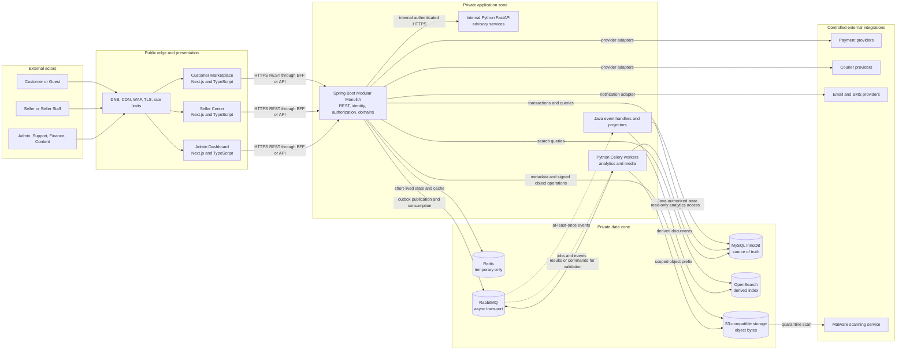
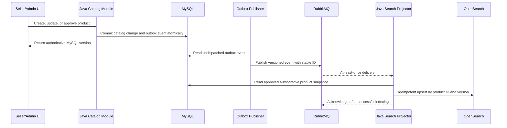
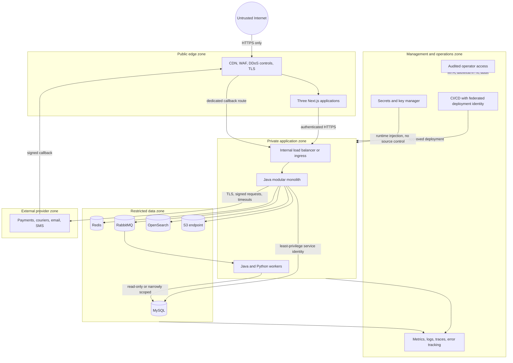
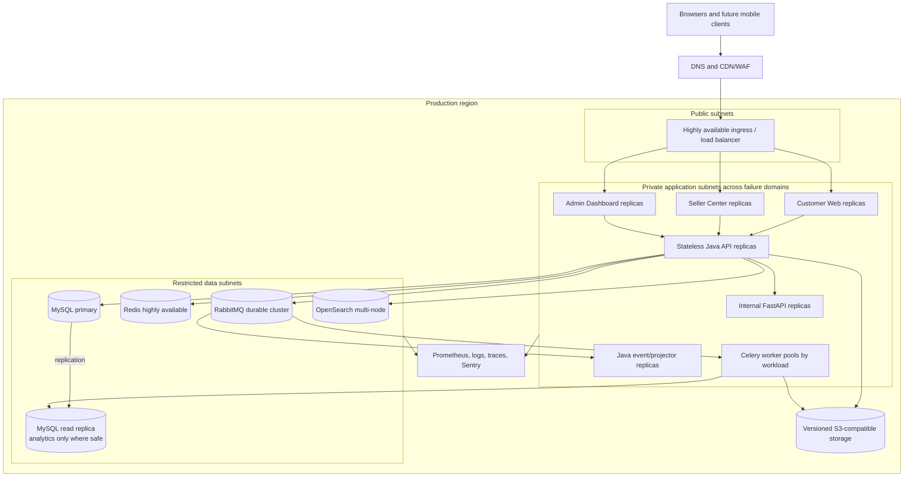

# Archim's TechCorner System Architecture

| Attribute | Value |
|---|---|
| Deliverable | 1 — System Architecture |
| Architecture style | Modular monolith with asynchronous workers |
| Status | Proposed for approval |
| Audience | Product, engineering, security, operations, and QA |
| Scope | Initial production architecture through Marketplace V1 |

## 1. Executive summary

Archim's TechCorner is a multi-vendor technology marketplace delivered through three independently deployable Next.js applications and one Java Spring Boot modular monolith. Java is the sole authority for identity and all critical marketplace state transitions. MySQL is the transactional source of truth; Redis holds only replaceable, short-lived data; OpenSearch contains rebuildable search projections; RabbitMQ transports asynchronous work; and S3-compatible object storage holds binary objects while MySQL owns their relational metadata.

The initial system deliberately avoids distributed business transactions and a large microservice estate. Domain modules have explicit boundaries inside one deployable Java codebase, communicate synchronously through application interfaces when a transaction must remain atomic, and publish durable events for asynchronous side effects. Those boundaries permit later extraction only when traffic, team ownership, deployment cadence, or isolation needs justify it.

Python services provide advisory analytics, recommendations, fraud signals, data preparation, and media processing. They do not mutate orders, payments, refunds, inventory reservations, balances, payouts, or other critical marketplace records. A Python result that affects transactional behavior is submitted to a Java API or event command, validated, authorized, and written by Java.

## 2. Goals, constraints, and quality attributes

### 2.1 Goals

- Support customer, seller, seller-staff, administrator, support, finance, and content-management journeys.
- Preserve financial and inventory correctness across multi-seller checkout, partial fulfillment, returns, refunds, and payouts.
- Keep the initial implementation understandable for a small team while providing enforceable module seams.
- Scale stateless web and Java application instances horizontally.
- Make non-authoritative stores disposable and rebuildable from authoritative data.
- Provide defense in depth, auditable administrative action, and least-privilege access.

### 2.2 Initial service objectives

| Capability | Objective | Architectural response |
|---|---:|---|
| Homepage | Under 2.5 seconds at the user | CDN, optimized S3 media, Next.js rendering, bounded API calls |
| Product search | Under 1 second | OpenSearch projection, pagination, query budgets |
| Add to cart | Under 500 ms | Indexed MySQL access with optional replaceable Redis cache |
| Standard MySQL query | Under 200 ms | Explicit indexes, query tracing, connection pooling, no N+1 queries |
| Checkout availability | At least 99.9% | Short transactions, durable reservations, idempotency, reconciliation |
| Payment reliability | At least 99.9% | Provider adapters, signed callbacks, durable state machine, reconciliation |

Performance targets are measured as percentiles under an agreed production workload, not as guarantees for every request. Exact percentile, traffic profile, and error-budget definitions belong in the operational SLO specification.

### 2.3 Non-goals for the initial architecture

- Independent microservices for each marketplace domain.
- Redis, OpenSearch, RabbitMQ, or Python as an authority for transactional state.
- Direct browser access to databases, queues, search clusters, or internal Python services.
- Direct Python writes to the transactional marketplace schema.
- Storing raw card data or large binary files in MySQL.

## 3. Architecture principles

1. **One transactional writer:** Java application services are the only writers of critical marketplace records.
2. **MySQL first:** A committed MySQL record is authoritative; caches, indexes, messages, and dashboards may lag and must be recoverable.
3. **Short local transactions:** Network calls never occur while inventory or financial rows are locked.
4. **Durable asynchronous handoff:** Business state and outbox events commit atomically; RabbitMQ publication follows the commit.
5. **Idempotency at every external boundary:** Retries and duplicate delivery are expected, not exceptional.
6. **Server-side authorization:** Every sensitive action is authorized in Java using role, permission, ownership, and state—not UI visibility.
7. **Least privilege by trust zone:** Each workload receives only the credentials and network access needed for its role.
8. **Observable by design:** Requests, transactions, messages, and provider calls share correlation identifiers and measurable outcomes.
9. **Rebuild derived state:** Search indexes and caches are reproducible from MySQL and object metadata.
10. **Extract only with evidence:** Module extraction follows measured operational or organizational need.

## 4. Technology responsibilities

| Technology | Responsibilities | Must not own |
|---|---|---|
| Next.js, React, TypeScript | Customer Marketplace, Seller Center, Admin Dashboard, rendering, accessible forms, client validation, query state, and same-origin BFF/proxy where used | Authorization decisions, prices, inventory truth, payment state, or independent identities |
| Java, Spring Boot | Authentication authority, authorization, validation, catalog, inventory, pricing, cart, checkout, orders, payments, fulfillment, returns, refunds, promotions, balances, payouts, audit, APIs, and transactional event creation | Raw card storage or long-running analytics/media computation |
| Python, FastAPI | Synchronous advisory scoring and bounded internal data-science APIs | Direct transactional writes or public browser APIs |
| Python, Celery | Analytics, report generation, image processing, cleanup, forecasting, recommendations, and fraud/ranking calculations | Final business decisions or mutation of critical records |
| MySQL 8+, InnoDB | Authoritative relational and transactional state, durable idempotency records, audit history, outbox/inbox records, and file metadata | Large binary objects or disposable cache entries |
| Redis | Sessions/cache acceleration, rate counters, OTPs, verification tokens, reservation-expiry hints, and short-lived notification state | Orders, payments, inventory, refunds, balances, payouts, or the only copy of any commitment |
| OpenSearch | Approved, denormalized product search documents, autocomplete, filters, and ranking fields | Product approval, price, inventory, or catalog truth |
| RabbitMQ | At-least-once command/event transport, worker routing, retry queues, and dead-letter queues | Long-term business history or authoritative workflow status |
| S3-compatible storage | Product media, seller documents, return/shipment evidence, and generated report bytes | Relational ownership, access policy decisions, or business workflow state |
| Prometheus and Grafana | Metrics, service-level dashboards, capacity and alerting views | Audit history or transactional truth |
| Sentry or equivalent | Application error aggregation and release diagnostics with sensitive-data scrubbing | Security audit log or secrets |
| Docker / deployment platform | Reproducible runtime packaging, health checks, scheduling, and scaling | Business orchestration |
| GitHub Actions | Build, test, scan, migration validation, image publication, and controlled deployment | Runtime secrets in logs or unreviewed production schema mutation |

## 5. System context and component architecture



All browser-facing API traffic passes through the controlled edge. OpenSearch, RabbitMQ, Redis, MySQL, object administration endpoints, internal workers, and internal FastAPI endpoints have no public ingress.

## 6. Java modular-monolith design

### 6.1 Domain modules

| Domain area | Required modules | Core ownership |
|---|---|---|
| Identity and accounts | Authentication, Users, Customers | Credentials, sessions, profiles, addresses, user status |
| Seller management | Sellers, Seller Staff, Stores | Onboarding, verification state, staff permissions, storefront identity |
| Catalog | Catalog, Categories, Brands, Products, Product Variants, Product Specifications | Approved product structure and descriptive data |
| Commercial rules | Pricing, Promotions, Vouchers | Prices, scheduled offers, eligibility, redemption constraints |
| Stock | Inventory, Warehouses | On-hand, reserved, adjustments, reservation lifecycle |
| Purchase | Shopping Cart, Checkout | Cart state, validation, quote snapshot, checkout orchestration |
| Order | Orders, Seller Orders | Parent customer order, per-seller order, immutable line snapshots, state transitions |
| Money movement | Payments, Refunds, Seller Balances, Seller Payouts | Provider transactions, refund ledger, commission, balance and payout state |
| Fulfillment | Shipping, Returns | Courier adapters, shipments, tracking, partial fulfillment, return lifecycle |
| Trust and engagement | Reviews, Product Questions | Eligibility, moderation, ratings, questions and answers |
| Platform services | Notifications, Audit Logs | Delivery requests/preferences and tamper-evident administrative/business audit trail |

### 6.2 Boundary rules

- Organize packages by feature. Each module owns its domain model, application services, persistence adapters, API DTOs, and tests.
- A module may access another module only through a documented application interface or published domain event. It must not import another module's repository or mutate its tables directly.
- JPA entities remain internal; REST contracts use validated DTOs and explicit mapping.
- Cross-module operations that require one atomic commit are coordinated by a Java application service and one MySQL transaction.
- Side effects that do not belong in that transaction use an outbox event and idempotent consumer.
- Database foreign keys preserve core integrity, but ownership still follows the module boundary. Flyway migrations are forward-only and reviewed by affected owners.
- Architecture tests should enforce allowed module dependencies and prevent boundary erosion.
- Provider integrations sit behind payment, courier, email/SMS, malware-scan, and object-storage ports so providers can change without changing domain rules.

### 6.3 Multi-seller aggregate model

A checkout creates one customer-facing parent order and one seller order for each seller. Line items store immutable checkout snapshots of product, variant, price, tax, discount, and seller attribution. Shipments, cancellations, returns, refunds, and payout eligibility attach at seller-order or line-item granularity. Parent status is a computed summary of its children, not a mechanism that erases partial states.

```text
Customer Order
├── Seller Order A
│   ├── Order Item A1
│   ├── Order Item A2
│   └── Shipment / Return / Refund / Payout states
└── Seller Order B
    ├── Order Item B1
    └── Shipment / Return / Refund / Payout states
```

## 7. Source-of-truth and ownership rules

| Information | Authoritative store | Authorized writer | Derived or temporary copies | Recovery rule |
|---|---|---|---|---|
| Users, roles, permissions, seller/customer profiles | MySQL | Java identity/account modules | Redis session/cache entries | Recreate cache; never infer identity from it |
| Product, category, brand, approval, price | MySQL | Java catalog/pricing modules | Redis cache; OpenSearch documents | Replay/reindex approved records from MySQL |
| Inventory and reservations | MySQL | Java inventory module | Redis expiration hint or availability cache | Expiry worker reads durable MySQL deadlines; cache loss cannot lose stock |
| Cart | MySQL for durable cart; Redis optional accelerator | Java cart module | Redis temporary representation | Fall back to and refresh from MySQL |
| Orders, payments, refunds, balances, payouts | MySQL | Corresponding Java modules only | Read models, metrics, analytics exports | Restore MySQL first and reconcile providers |
| Business/audit events | MySQL business tables plus audit/outbox history | Java | RabbitMQ delivery and downstream projections | Republish undispatched outbox events |
| Search documents | OpenSearch, explicitly non-authoritative | Java-controlled projector | None | Create a new index from MySQL and atomically switch alias |
| Object bytes | S3-compatible storage | Java-issued signed upload flow; tightly scoped workers | CDN copies and thumbnails | Restore/version objects; validate against MySQL metadata |
| Object metadata, owner, relation, order, scan status | MySQL | Java file-owning module | Search/report projections | Reconcile object inventory to MySQL; quarantine orphans |
| Analytics, scores, recommendations | Analytics outputs, versioned by model/run | Python for non-transactional outputs; Java for accepted business state | Dashboard/search projections | Recompute from authoritative inputs; never overwrite transactional truth |
| Queue messages | Not a source of truth | Outbox publisher and approved producers | RabbitMQ queues/DLQs | Replay outbox or regenerate from MySQL |

Additional rules:

- MySQL uses InnoDB, `utf8mb4`, `utf8mb4_0900_ai_ci`, foreign keys, unique business identifiers, and `DECIMAL(15,2)` or a documented higher precision for money—never floating point.
- Python's marketplace-schema credential is read-only. A Python-produced recommendation, fraud signal, or category suggestion becomes business state only after Java validates and records it.
- OpenSearch receives only approved product data. Search results return identifiers; Java revalidates current visibility, price, and availability where correctness matters.
- RabbitMQ provides at-least-once delivery. Every consumer uses a stable event identifier, inbox/deduplication record, bounded retries, and a dead-letter route.
- S3 URLs are not permanent authorization. Private objects use short-lived signed operations; public product media is published only after validation, scanning, and moderation.

## 8. Data flows

### 8.1 Read and search flow

1. The browser reaches the appropriate Next.js application through CDN/WAF controls.
2. The application calls the Java API using the authenticated same-origin path where applicable.
3. Java applies request validation, visibility, tenant/owner scoping, and authorization.
4. Product detail reads use MySQL and a replaceable Redis cache; search uses OpenSearch.
5. Java overlays or revalidates volatile price and availability when a result is used for cart or checkout.
6. Media is delivered through a CDN from approved S3 objects.

### 8.2 Transaction-safe checkout and payment flow

> **Approval decision — proposed production correction to the literal prompt sequence:** The prompt places external payment authorization inside the inventory transaction. The architecture must not hold MySQL row locks across an unbounded network call. Use a reservation/authorization/finalization saga with two short MySQL transactions. This preserves stock safety, order/payment traceability, idempotency, rollback intent, and compensation while avoiding lock exhaustion and cascading checkout failure. Product and engineering owners must approve this decision before implementation.

```mermaid
sequenceDiagram
    autonumber
    actor C as Customer
    participant J as Java Checkout API
    participant DB as MySQL
    participant O as Outbox Publisher
    participant Q as RabbitMQ
    participant P as Java Payment Orchestrator
    participant PSP as Payment Provider

    C->>J: Submit checkout with idempotency key
    J->>DB: Begin transaction A
    J->>DB: Claim idempotency key and lock inventory rows
    J->>DB: Validate stock and create durable reservations
    J->>DB: Create parent/seller orders, items, and pending payment
    J->>DB: Insert PaymentAuthorizationRequested outbox event
    J->>DB: Commit transaction A and release locks
    J-->>C: Return pending order and status URL
    O->>DB: Read undispatched outbox event
    O->>Q: Publish event with stable event ID
    Q-->>P: Deliver event at least once
    P->>PSP: Authorize using provider idempotency key
    PSP-->>P: Authorized, declined, or indeterminate
    P->>DB: Begin short transaction B
    P->>DB: Lock reservation/payment and deduplicate result
    alt authorized
        P->>DB: Confirm reservation and advance payment/order states
        P->>DB: Insert checkout-confirmed outbox events
    else declined or expired
        P->>DB: Release reservation and cancel pending order/payment
        P->>DB: Insert checkout-failed outbox event
    else indeterminate
        P->>DB: Mark reconciliation required; retain until bounded expiry
    end
    P->>DB: Commit transaction B
    C->>J: Read checkout status or safely retry original key
    J->>DB: Read authoritative result
    J-->>C: Return confirmed, failed, or pending
```

Required invariants and failure handling:

- Inventory rows are locked in a deterministic order during each short transaction; available stock cannot become negative.
- The checkout idempotency key and request fingerprint are unique in MySQL. A retry returns the original resource or rejects a conflicting payload.
- Provider authorization/callback identifiers, refund identifiers, payout identifiers, and shipment-update identifiers have unique constraints.
- An authorization that succeeds while finalization fails is found by reconciliation and retried or voided. Compensation is durable state, not a best-effort log line.
- Reservation expiry is durable in MySQL. Redis may schedule an early wake-up, but a MySQL sweeper is the correctness backstop.
- Payment callbacks are signature-verified, timestamp/replay checked, recorded idempotently, and passed through the same state machine.
- Clients can receive `pending` and poll or subscribe for the eventual result; they must not create another checkout with a new key simply because a request timed out.

### 8.3 Catalog-to-search projection



Delete/unpublish events remove documents. A periodic reconciliation compares approved MySQL records with index versions. Full rebuild writes a versioned index and switches an alias only after validation.

### 8.4 Media and Python processing flow

1. Java validates file intent, owner, type, declared size, and authorization, then creates a pending metadata row and short-lived signed upload.
2. The client uploads to a quarantine prefix using a random object key; object storage is never trusted based on file extension alone.
3. An event triggers malware scanning and Python image/video validation or transformation.
4. The worker writes outputs only to its scoped prefix and reports hashes, dimensions, and status through an authenticated Java API or validated event.
5. Java records the accepted metadata and makes approved public media publishable. Rejected objects remain quarantined and expire by lifecycle policy.

## 9. Authentication and authorization boundary

Spring Security in the Java backend is the identity authority. The three frontends are clients and presentation layers; NextAuth, if used, is only an integration/session adapter and must not create a second user, role, permission, or token authority.

Recommended browser pattern:

- Java issues a short-lived access token and a rotated opaque refresh token. Only a hash of each refresh token is stored with user, device/session, expiry, rotation family, and revocation state in MySQL.
- Tokens are carried in `Secure`, `HttpOnly`, `SameSite=Lax` cookies scoped as narrowly as deployment permits. A per-application Next.js BFF/proxy may keep credentials server-side and forward authenticated requests; it does not decide authorization.
- Cookie-authenticated state-changing requests require CSRF protection using an origin check plus Spring Security CSRF token pattern. `SameSite` is defense in depth, not the sole CSRF control.
- Access tokens remain brief-lived; refresh tokens rotate on every use. Reuse of an invalidated predecessor revokes the token family and raises a security event.
- Redis may accelerate session/revocation checks, but durable refresh-family and revocation truth remains in MySQL.
- Java checks RBAC permissions on every endpoint and applies resource ownership, seller/store membership, finance separation-of-duties, and valid domain-state checks inside the application service.
- Seller staff receive explicit store-scoped permissions. Admin, support, finance, and content roles receive only the actions required for their duties; privileged actions require MFA and auditable reason/context.
- Passwords use Argon2id or BCrypt with centrally managed parameters. Email/phone verification, suspicious-login detection, device history, rate limits, lockout controls, and MFA recovery are server-controlled.

## 10. Security boundaries and controls



### 10.1 Boundary controls

| Boundary | Required controls |
|---|---|
| Internet to edge | TLS, HSTS, DDoS/WAF rules, request-size limits, bot/rate controls, CSP and secure headers |
| Edge/web to Java | Explicit CORS allowlist if cross-origin, CSRF controls for cookies, schema validation, request IDs, authentication |
| Java to data stores | Private networking, TLS, separate service identities, credential rotation, connection limits, encryption at rest |
| Java/Python worker boundary | Mutual workload identity or signed internal tokens, queue ACLs, payload schemas, size limits, no trust of model output |
| Provider boundary | Adapter isolation, egress allowlist where possible, strict timeouts, retry budgets, circuit breakers, signature verification, replay protection |
| Operator boundary | SSO/MFA, just-in-time privilege, separation of duties, approval for high-risk finance actions, immutable audit trail |
| File boundary | Quarantine, magic-byte/type/size checks, decompression limits, malware scan, random keys, signed URLs, metadata stripping as appropriate |

MySQL is never publicly addressable. Use distinct MySQL accounts for the Java runtime, Flyway migrations, read-only analytics, and backup/restore. Production credentials come from a secrets manager and are neither committed nor baked into images. Sensitive fields and backups are encrypted; keys are separated from ciphertext. Logs, traces, error reports, and analytics exports redact credentials, tokens, payment details, identity documents, and unnecessary personal data.

## 11. Deployment architecture



Production uses managed equivalents where practical. Local development uses Docker Compose with the same logical dependencies but no claim of production high availability. Development, test, staging, and production use separate accounts/networks, databases, queues, buckets, indexes, credentials, and encryption keys. Container images are immutable and promoted between environments. Flyway runs once as a controlled deployment step before compatible application rollout; application replicas do not race migrations on startup.

## 12. Reliability and consistency

### 12.1 Transaction and concurrency controls

- Use pessimistic row locking for inventory reservation/finalization, acquired in deterministic key order.
- Use optimistic version columns for suitable catalog and administrative edits; return a conflict instead of silently overwriting.
- Use unique constraints as the final defense for order numbers, provider transaction IDs, idempotency keys, callbacks, refunds, and payouts.
- Represent payment, order, shipment, return, refund, and payout lifecycles as explicit state machines with legal transitions.
- Never use distributed transactions across MySQL and a provider, queue, cache, search index, or object store.
- Use transactional outbox for publication and inbox/deduplication for consumers. Event payloads are versioned and contain identifiers, not secrets or full sensitive records.

### 12.2 Resilience patterns

- Apply short connect/read deadlines, bounded exponential backoff with jitter, and circuit breakers to provider and internal network calls.
- Retry only operations proven idempotent. Route exhausted asynchronous work to a monitored dead-letter queue with a documented replay procedure.
- Isolate worker queues and concurrency by workload so image processing or reports cannot starve payment/search projection work.
- Apply bulkheads, connection-pool limits, queue length limits, and backpressure. Autoscaling must respect downstream database and provider capacity.
- Use readiness checks for dependencies needed to serve traffic and liveness checks only for process deadlock. Avoid restart storms caused by transient dependency failure.
- Degrade safely: browsing may omit recommendations; checkout must reject or remain pending rather than guess stock, price, or payment success.

### 12.3 Backup and disaster recovery

- MySQL: daily encrypted full backups, binary logging, point-in-time recovery, off-site copies, retention policy, and monthly restoration tests.
- Object storage: versioning, lifecycle/retention rules, encryption, replication or backup consistent with recovery objectives.
- Redis and OpenSearch are rebuilt or repopulated; RabbitMQ is drained/reconciled against the outbox after recovery.
- Define and test business-approved RPO/RTO values before launch.
- Recovery order is: restore MySQL; validate financial records; validate inventory; restore object access; rebuild OpenSearch; reconnect Redis; resume RabbitMQ publishers/workers; reconcile providers and queues.

## 13. Observability and operations

Every request receives a correlation ID. Authenticated logs may include internal user/store/order identifiers where necessary, but not tokens, credentials, raw payment data, identity documents, or unrestricted personal information. OpenTelemetry-compatible trace context propagates through HTTP, outbox events, RabbitMQ headers, workers, and provider adapters.

| Signal | Minimum coverage |
|---|---|
| Metrics | Request rate/error/duration, JVM/Python runtime, DB pool/query/lock wait, cache hit rate, search latency, queue depth/age/retry/DLQ, outbox lag, worker duration, provider outcomes, business funnel counters |
| Structured logs | Timestamp, severity, service/module, environment, release, trace/correlation/event ID, safe entity identifiers, state transition, outcome and normalized error code |
| Traces | Browser/BFF where supported, Java endpoints, module/application spans, SQL summaries, Rabbit publish/consume, Python jobs, provider calls |
| Error tracking | Release-tagged JavaScript, Java, and Python exceptions with source maps and privacy scrubbing |
| Audit | Login/security events, seller/admin changes, product moderation, price/stock adjustments, payment/refund/payout actions, role/permission changes, evidence access |

Initial alerts cover checkout and payment SLO burn, elevated 5xx/latency, inventory lock waits, DB saturation/replication lag, outbox lag, queue age and DLQ growth, search cluster health, failed backups, certificate/secret expiry, callback signature failures, suspicious login spikes, and missing telemetry. Alerts must be actionable, routed by severity, and linked to runbooks.

## 14. Architecture decisions

| ID | Decision | Status | Consequence |
|---|---|---|---|
| ADR-001 | Begin with a feature-modular Java monolith | Proposed | Simpler atomic transactions and operations; module dependency tests are mandatory |
| ADR-002 | Java is the only critical transactional writer | Proposed | Central validation/audit; Python and UI submit proposals through controlled interfaces |
| ADR-003 | MySQL is the marketplace source of truth | Proposed | Strong integrity and recovery anchor; derived stores tolerate bounded lag |
| ADR-004 | Use outbox/inbox with at-least-once RabbitMQ delivery | Proposed | Avoids DB/queue dual-write loss; requires deduplication, lag monitoring, and replay tooling |
| ADR-005 | Use two short checkout transactions around payment authorization | **Proposed — approval required** | Avoids locks during network I/O; requires durable pending states, reconciliation, and compensation |
| ADR-006 | Redis is temporary and replaceable | Proposed | Cache/session loss may reduce performance or require login, never corrupt commitments |
| ADR-007 | OpenSearch holds only approved, rebuildable projections | Proposed | Search is eventually consistent and reindexing is a supported operation |
| ADR-008 | S3 stores bytes; MySQL stores ownership and workflow metadata | Proposed | Scalable media handling; requires reconciliation, quarantine, and signed access |
| ADR-009 | Java/Spring Security is the sole identity authority | Proposed | Consistent RBAC/audit; frontend auth libraries remain clients/adapters |
| ADR-010 | Use provider ports/adapters for payments and couriers | Proposed | Provider replacement and testing are isolated from core state machines |
| ADR-011 | Separate customer, seller, and admin frontends | Proposed | Independent UX/release controls; shared packages need version discipline |
| ADR-012 | Do not extract a module without measured need | Proposed | Prevents premature distributed complexity; extraction criteria must be recorded |

### 14.1 Extraction criteria

A module becomes a service candidate only when at least one sustained condition exists and the data/consistency cost is acceptable: independent scaling materially lowers risk/cost; separate team ownership and release cadence are blocked by the monolith; regulatory or security isolation is required; fault isolation cannot be achieved in-process; or a workload has incompatible runtime/resource characteristics. Extraction begins at an existing application interface/event boundary and includes explicit data ownership, migration, observability, and rollback plans.

## 15. Architecture acceptance checklist

This deliverable is ready for implementation planning when stakeholders approve:

- The Java-only transactional writer and MySQL source-of-truth rules.
- The two-short-transaction checkout/payment saga in ADR-005, including pending UX and compensation behavior.
- The Java identity authority, cookie/token pattern, and server-side authorization boundary.
- The multi-seller parent/seller-order model and partial-operation granularity.
- The modular boundaries and forbidden direct repository/table access across modules.
- The outbox/inbox, idempotency, reconciliation, and dead-letter responsibilities.
- The private network boundaries and separate service/database identities.
- The initial SLO measurement definitions, production RPO/RTO, retention, and data-residency requirements.

The database design, project structure, and roadmap are delivered alongside this document as the initial review package. Detailed API contracts, scaffolding, migrations, and implementation code begin only after all four initial deliverables and their open decisions are approved.
