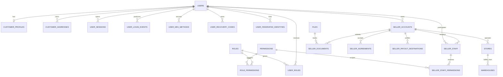
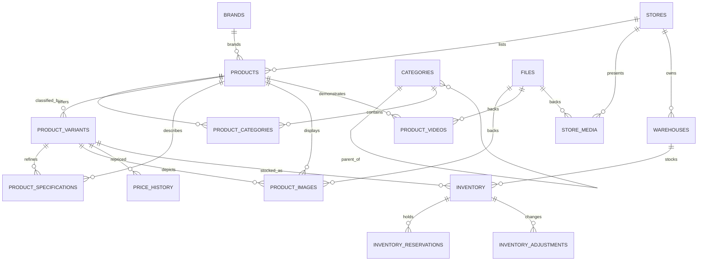
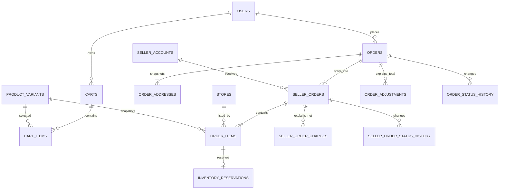
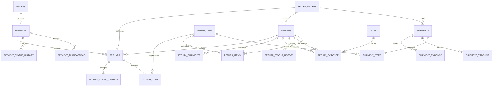

# Archim’s TechCorner — MySQL Database Design

| Document property | Value |
|---|---|
| Deliverable | 2 — MySQL Database Design |
| Status | Proposed for architecture approval |
| Database | MySQL 8 or newer; MySQL 8.4 LTS is the recommended production baseline |
| Storage engine | InnoDB only |
| Schema ownership | The Java marketplace application is the sole writer of transactional data |
| Time standard | UTC |

## 1. Purpose and scope

This document defines the production logical data model for the Archim’s TechCorner multi-vendor marketplace. It covers the required entities, keys, relationships, constraints, indexes, monetary rules, concurrency strategy, transaction boundaries, lifecycle controls, and analytics boundary. It is intentionally implementation-neutral: Flyway migrations and application code begin only after this design is approved.

MySQL is the source of truth for users, catalog state, inventory, orders, money movement, fulfillment, returns, and audit evidence. Redis contains only temporary accelerators, OpenSearch contains rebuildable approved-product projections, RabbitMQ transports events, and object storage contains binary files whose metadata remains in MySQL.

### 1.1 Goals

- Preserve financial and inventory correctness under concurrent checkouts and duplicated provider callbacks.
- Represent one checkout containing many sellers without losing customer-level or seller-level totals.
- Support partial cancellation, shipment, return, refund, and payout.
- Make every important state transition attributable and replay-safe.
- Keep the initial modular monolith understandable while leaving clean extraction boundaries.
- Give analytics useful data without granting it authority over transactional records or unrestricted PII.

### 1.2 Explicit non-goals

- OpenSearch index structure, Redis key design, and message payload schemas.
- Physical migration scripts, SQL, ORM mappings, or service implementation.
- A multi-region active/active write topology.
- General-purpose accounting or foreign-exchange conversion in the MVP.

## 2. Decisions requiring approval

| ID | Proposed decision | Rationale |
|---|---|---|
| DB-01 | Use unsigned `BIGINT` surrogate primary keys and separate non-sequential `public_id` values for externally exposed resources. | Compact joins and indexes remain efficient without exposing predictable internal identifiers. |
| DB-02 | Store business money as `DECIMAL(15,2)` with a mandatory ISO 4217 `currency_code`; the MVP accepts only currencies with two minor-unit digits. | Meets the prompt’s fixed financial type while avoiding ambiguous rounding for zero- or three-decimal currencies. |
| DB-03 | Use `VARCHAR` status codes plus application transition policies and database checks, rather than MySQL `ENUM`. | Statuses can evolve through migrations without tightly coupling storage to an enum definition. |
| DB-04 | Use short, explicit transactions and deterministic row-lock order for inventory, voucher usage, refunds, and payouts. | Prevents overselling and reduces deadlock probability. |
| DB-05 | Use a transactional outbox and durable inbox/idempotency records. | Database commits and asynchronous/provider effects cannot otherwise be atomic. |
| DB-06 | Treat immutable ledger entries as the authority for seller money; `seller_balances` is a lockable projection. | Every balance change remains explainable and reconcilable. |
| DB-07 | Prefer `READ COMMITTED` for the application connection pool, with explicit locking for invariants. | Reduces unnecessary gap locking; correctness comes from row locks, unique constraints, counters, and short transactions. Validate this under concurrency tests before production. |
| **DB-08** | **Replace the prompt’s single checkout transaction with a two-short-transaction reservation/authorization/finalization workflow. Never hold MySQL locks while calling a payment provider.** | **An external authorization can take seconds, time out ambiguously, or retry. Holding inventory locks during that call would exhaust connections, amplify deadlocks, and reduce checkout availability. Section 9 is the recommended design decision for approval.** |

## 3. System-of-record boundaries

| Data class | Authority | Other-system rule |
|---|---|---|
| Accounts, catalog, orders, payments, inventory, refunds, balances, payouts | MySQL through the Java application | No other service may directly modify these records. |
| Sessions, OTPs, rate limits, reservation-expiry wakeups, caches | Redis | Temporary only; loss must not change durable truth. Reservation rows in MySQL remain authoritative. |
| Search documents | OpenSearch | Approved-product copy only; rebuilt from MySQL and outbox events. |
| Images, video, evidence, documents, reports | S3-compatible object storage | MySQL `files` rows store ownership, classification, checksum, and object key; no large blobs in MySQL. |
| Analytics, recommendations, fraud scores | Python services | Consume APIs, events, exports, or restricted read-only views. They never write critical tables. |
| Integration delivery | RabbitMQ | At-least-once transport; consumers deduplicate through `inbox_events`. |

## 4. Modeling conventions

### 4.1 Names, identifiers, and keys

- Tables and columns use lowercase `snake_case`; foreign keys use `<entity>_id`.
- Every table has one unsigned `BIGINT` primary key named `id`, except pure join tables where the documented composite key is sufficient. A uniform surrogate key may still be added if the ORM requires it.
- Customer-visible entities also have a unique, immutable `public_id` stored in a UUID-compatible compact form. Human-facing references such as `order_number`, `return_number`, and `payout_number` are separate unique values and contain no business meaning that must be parsed.
- Foreign-key columns use the exact type and signedness of their parent key.
- Authentication tokens, idempotency keys, and provider secrets are stored as hashes or provider tokens, never as reusable cleartext.

### 4.2 Time and versioning

- Business timestamps use UTC `DATETIME(6)` so provider ordering and concurrent events retain microsecond precision. The API converts UTC to the user’s timezone.
- Mutable rows normally contain `created_at`, `updated_at`, and an integer `version` used for optimistic locking.
- Immutable event, ledger, history, and audit rows contain `created_at` or `occurred_at` but are never updated in ordinary operation.
- An expiry is explicit (`expires_at`) and is interpreted by database/server time synchronized through NTP. Redis may schedule cleanup, but cannot decide whether a hold is valid.

### 4.3 Text, JSON, and booleans

- Default character set and collation are `utf8mb4` and `utf8mb4_0900_ai_ci`.
- Security-sensitive tokens, hashes, object keys, normalized voucher codes, and provider references use binary or case-sensitive comparison semantics.
- `VARCHAR` is used for bounded values and `TEXT` for long prose.
- JSON is allowed for non-authoritative provider metadata, redacted audit diffs, and presentation snapshots only. Relationships, amounts, quantities, status, ownership, and searchable specifications remain relational.
- Boolean flags use MySQL’s boolean-compatible representation and always have an explicit default.

### 4.4 Foreign keys and deletion defaults

- Every modeled relationship has a foreign key unless it intentionally references an external system or an audit snapshot.
- Restrict deletion for orders, money, inventory history, moderation evidence, and audit data.
- Cascade only ownership-bound, non-financial children such as cart items or role assignments.
- Set-null is limited to optional attribution such as a deleted staff actor; an immutable actor label remains in the history/audit row.
- Soft deletion is used only for operationally restorable entities such as users, stores, products, and vouchers. A status plus `deleted_at` is preferred to a generic hidden flag.

### 4.5 Index rules

- Every foreign key has a supporting index whose leftmost columns match common access paths.
- Unique constraints enforce business identity and idempotency; application checks are not substitutes.
- MySQL permits multiple `NULL` values in a unique index. At-most-one rules for root scopes, current assignments, and optional parents therefore use a documented non-null generated scope key, an active-row marker, or separate current/history tables; they never rely on nullable uniqueness accidentally.
- Composite indexes place equality/tenant columns first, then status, then time/range columns.
- Customer and seller list views use stable keyset pagination, normally `(created_at, id)` or `(status, created_at, id)`.
- Avoid single-column indexes already covered by the left edge of a composite index.
- Index only bounded prefixes or normalized helper columns for long text. Full-text product discovery belongs in OpenSearch.
- Production query plans are verified using representative cardinality before an index is accepted; unused and overlapping indexes are removed deliberately.

Where a child repeats ancestor keys for a hot access path, compound foreign keys enforce ancestry consistency. Examples include an order item’s `(seller_order_id, order_id)`, a variant-scoped specification’s `(variant_id, product_id)`, and a seller order’s store/seller ownership. If a multi-hop ownership rule cannot be expressed cleanly as a foreign key, the Java command validates it in the same transaction and a database integration test proves the rejection path.

## 5. Logical entity-relationship diagrams

The diagrams are split by transaction boundary so they remain readable. They show primary relationships, not every attribution column or history edge. Tables labeled as supporting in the catalog are deliberate additions needed to make the required model enforceable.

### 5.1 Identity, authorization, and sellers



### 5.2 Catalog and inventory



### 5.3 Cart and multi-seller orders



### 5.4 Payments, fulfillment, returns, and refunds



### 5.5 Promotions, seller finance, engagement, and reliability

```mermaid
erDiagram
    CAMPAIGNS ||--o{ CAMPAIGN_PRODUCTS : targets
    PRODUCTS ||--o{ CAMPAIGN_PRODUCTS : participates
    CAMPAIGNS ||--o{ CAMPAIGN_CATEGORIES : targets
    CATEGORIES ||--o{ CAMPAIGN_CATEGORIES : participates
    CAMPAIGNS ||--o{ CAMPAIGN_STORES : targets
    STORES ||--o{ CAMPAIGN_STORES : participates
    CAMPAIGNS ||--o{ VOUCHERS : issues
    VOUCHERS ||--o{ VOUCHER_USAGE : consumed_as
    ORDERS ||--o{ VOUCHER_USAGE : redeems
    SELLER_ACCOUNTS ||--o{ SELLER_BALANCES : owns
    SELLER_BALANCES ||--o{ SELLER_LEDGER_ENTRIES : derives_from
    SELLER_ACCOUNTS ||--o{ SELLER_PAYOUTS : requests
    SELLER_PAYOUT_DESTINATIONS ||--o{ SELLER_PAYOUTS : receives
    SELLER_PAYOUTS ||--|{ SELLER_PAYOUT_ITEMS : settles
    SELLER_LEDGER_ENTRIES ||--o| SELLER_PAYOUT_ITEMS : included_in
    PRODUCTS ||--o{ REVIEWS : receives
    ORDER_ITEMS ||--o| REVIEWS : verifies
    PRODUCTS ||--o{ PRODUCT_QUESTIONS : receives
    PRODUCT_QUESTIONS ||--o{ PRODUCT_QUESTION_ANSWERS : answered_by
    USERS ||--o{ NOTIFICATIONS : receives
    NOTIFICATIONS ||--o{ NOTIFICATION_DELIVERIES : attempts
    IDEMPOTENCY_RECORDS ||--o{ OUTBOX_EVENTS : produces
    USERS ||--o{ AUDIT_LOGS : acts
    USERS ||--o{ GENERATED_REPORTS : requests
    FILES ||--o{ GENERATED_REPORTS : backs
    USERS ||--o{ STORED_VALUE_ACCOUNTS : owns
    STORED_VALUE_ACCOUNTS ||--o{ STORED_VALUE_LEDGER_ENTRIES : records
```



## 6. Core table catalog

“Required” means the table is named in the master prompt. “Supporting” means it is added because a required relationship or invariant cannot be represented safely without it. Unless noted otherwise, mutable tables include audit timestamps and `version`; history and ledger tables are append-only.

### 6.1 Identity and access

| Table | Class | Core data and purpose | Primary key | Foreign keys | Unique constraints | Important indexes/checks |
|---|---|---|---|---|---|---|
| `users` | Required | Login principal, normalized email/phone, password hash, email/phone verification times, durable account/risk state, `locked_until`, and failed-login security version; no role booleans | `id` | Optional `created_by_user_id → users.id` | `public_id`; normalized email; normalized phone when present | `(status, locked_until)`; `(status, created_at, id)`; `deleted_at`; check at least one login identity; password is a one-way hash; Redis counters may accelerate but never erase durable lockout |
| `roles` | Supporting | Platform roles such as CUSTOMER, SELLER, ADMIN, SUPPORT, FINANCE, CONTENT | `id` | — | `code` | `(is_active, code)` |
| `permissions` | Supporting | Atomic platform capabilities | `id` | — | `code` | `(module, code)` |
| `user_roles` | Required | Time-bounded assignment of platform roles | `id` | `user_id → users`; `role_id → roles`; `granted_by_user_id → users`; optional `revoked_by_user_id → users` | Generated active-row uniqueness `(user_id, role_id, active_marker)`, where active rows use a non-null marker and historical rows use `NULL` | `(role_id, active_marker, user_id)`; expiry; grant and revoke timestamps; revoked rows are immutable history |
| `role_permissions` | Supporting | Many-to-many role capability map | Composite `(role_id, permission_id)` | `role_id → roles`; `permission_id → permissions` | Primary key | Reverse index `(permission_id, role_id)` |
| `customer_profiles` | Required | Customer display name, locale, timezone, preferences, date-of-birth classification where permitted | `id` | `user_id → users` | `user_id`; `public_id` | Display name lookup only if required; sensitive fields encrypted or minimized |
| `customer_addresses` | Required | User-managed delivery/billing address book | `id` | `customer_id → users` | Optional `(customer_id, address_fingerprint)` | `(customer_id, address_type, is_default)`; country/postal lookup; exactly one default per type enforced transactionally |
| `user_sessions` | Supporting | Refresh-session family, hashed token identifier, device label, expiry, revocation | `id` | `user_id → users`; optional `replaced_by_session_id → user_sessions` | `token_hash`; `public_id` | `(user_id, revoked_at, expires_at)`; `(expires_at)` for cleanup |
| `user_login_events` | Supporting | Immutable successful/failed login and device history | `id` | Optional `user_id → users` | Optional provider event/deduplication key | `(user_id, occurred_at, id)`; `(outcome, occurred_at)`; IP/user-agent data protected and retention-limited |
| `user_mfa_methods` | Supporting | Versioned TOTP/WebAuthn/approved factor metadata, encrypted secret where applicable, credential public key, verification, status, and last use | `id` | `user_id → users` | `public_id`; provider/WebAuthn credential identifier when present | `(user_id, status, created_at)`; secrets encrypted with external KMS keys; at least one active method required for privileged roles |
| `user_recovery_codes` | Supporting | One-time MFA recovery-code hashes with issue batch, expiry, and consumption evidence | `id` | `user_id → users`; optional `mfa_method_id → user_mfa_methods` | `code_hash` | `(user_id, used_at, expires_at)`; clear recovery code is shown once and never stored |
| `user_federated_identities` | Supporting | External/social provider link using stable provider subject, link/verification state, and timestamps | `id` | `user_id → users` | `(provider_code, provider_subject)`; `(user_id, provider_code)` when only one identity per provider is allowed | `(user_id, status)`; provider email is informational and never silently merges accounts |

### 6.2 Sellers, stores, and file metadata

| Table | Class | Core data and purpose | Primary key | Foreign keys | Unique constraints | Important indexes/checks |
|---|---|---|---|---|---|---|
| `seller_accounts` | Required | Legal seller entity, type, verification/risk/payout state, tax profile reference | `id` | `owner_user_id → users`; optional approving actor to `users` | `public_id`; legal registration identifier hash within country | `(status, submitted_at, id)`; `(risk_level, status)`; sensitive identifiers encrypted/tokenized |
| `seller_staff` | Required | Links a user to a seller with employment status and invitation lifecycle | `id` | `seller_account_id → seller_accounts`; `user_id → users`; inviter to `users` | `(seller_account_id, user_id)` | `(user_id, status)`; `(seller_account_id, status)` |
| `seller_staff_permissions` | Supporting | Seller-scoped permission overrides for staff | Composite `(seller_staff_id, permission_id)` | `seller_staff_id → seller_staff`; `permission_id → permissions`; grantor to `users` | Primary key | `(permission_id, seller_staff_id)`; optional expiry |
| `files` | Supporting | Object-storage key, media type, byte size, checksum, malware-scan state, classification, uploader | `id` | `uploaded_by_user_id → users` | `public_id`; `storage_bucket + object_key` | `(owner_type, owner_public_id)` is lookup metadata, not an FK; `(scan_status, created_at)`; size non-negative; binary never stored here |
| `seller_documents` | Required | Versioned identity/business/tax/bank-verification document metadata and review outcome | `id` | `seller_account_id → seller_accounts`; `file_id → files`; reviewer to `users` | `(seller_account_id, document_type, version_number)`; `file_id` | `(seller_account_id, status, document_type)`; expiry review queue |
| `stores` | Required | Public storefront, slug, moderation status, ratings projection, policy settings | `id` | `seller_account_id → seller_accounts`; optional moderation actor to `users` | `public_id`; normalized `slug`; `(seller_account_id, normalized_name)` | `(seller_account_id, status)`; `(status, created_at, id)`; archived stores retain identity |
| `warehouses` | Required | Seller fulfillment location, normalized address, timezone, active state | `id` | `store_id → stores`; optional address owner/actor to `users` | `public_id`; `(store_id, warehouse_code)` | `(store_id, is_active)`; country/postal region; location PII access restricted |

### 6.3 Catalog, variants, and pricing

| Table | Class | Core data and purpose | Primary key | Foreign keys | Unique constraints | Important indexes/checks |
|---|---|---|---|---|---|---|
| `categories` | Required | Category tree, normalized slug, display order, moderation state | `id` | Optional `parent_id → categories` | `public_id`; normalized `slug`; `(parent_id, normalized_name)` | `(parent_id, status, display_order)`; prohibit self-parent and cycles in service validation |
| `brands` | Required | Canonical brand identity and moderation status | `id` | Optional approving actor to `users` | `public_id`; normalized name; normalized slug | `(status, normalized_name)` |
| `products` | Required | Store listing, title/description, condition, warranty, approval and lifecycle status | `id` | `store_id → stores`; optional `brand_id → brands`; `primary_category_id → categories`; moderation actor to `users` | `public_id`; `(store_id, normalized_slug)` | `(store_id, status, updated_at, id)`; `(primary_category_id, status, id)`; `(brand_id, status, id)`; deleted/archived state |
| `product_categories` | Supporting | Additional product-category classifications | Composite `(product_id, category_id)` | `product_id → products`; `category_id → categories` | Primary key | `(category_id, product_id)` |
| `product_variants` | Required | Purchasable SKU, option label, barcode, dimensions, current regular/sale price, currency, lifecycle state | `id` | `product_id → products` | `public_id`; global platform `sku`; `(product_id, seller_sku)`; barcode when present | `(product_id, status, id)`; `(status, updated_at)`; prices non-negative and sale price not above regular price |
| `product_specifications` | Required | Relational specification key/value with optional unit and variant override | `id` | `product_id → products`; optional `variant_id → product_variants` | `(product_id, variant_id, normalized_name)` | `(product_id, normalized_name, normalized_value)`; variant must belong to product; typed value columns are preferred for filterable specifications |
| `product_images` | Required | Ordered product/variant image metadata, alt text, purpose, moderation state | `id` | `product_id → products`; optional `variant_id → product_variants`; `file_id → files` | `file_id`; `(product_id, variant_id, display_order)` | `(product_id, is_primary, display_order)`; variant must belong to product; exactly one primary per display scope enforced transactionally |
| `price_history` | Required | Immutable old/new price, reason, actor, and effective time for a variant | `id` | `variant_id → product_variants`; optional campaign and actor | Optional `(variant_id, change_reference)` | `(variant_id, effective_at, id)`; exact currency match; old/new amounts non-negative |

### 6.4 Inventory

| Table | Class | Core data and purpose | Primary key | Foreign keys | Unique constraints | Important indexes/checks |
|---|---|---|---|---|---|---|
| `inventory` | Required | One stock bucket per warehouse and variant: `on_hand_quantity`, `reserved_quantity`, reorder threshold, version | `id` | `warehouse_id → warehouses`; `variant_id → product_variants` | `(warehouse_id, variant_id)` | `(variant_id, warehouse_id)`; low-stock query; `on_hand_quantity ≥ 0`, `reserved_quantity ≥ 0`, `reserved_quantity ≤ on_hand_quantity` |
| `inventory_reservations` | Required | Durable quantity hold for one order item and inventory bucket, with HELD/CONFIRMED/RELEASED/CONSUMED/EXPIRED state | `id` | `inventory_id → inventory`; optional `order_item_id → order_items`; `order_id → orders` | `public_id`; reservation idempotency key; `(order_item_id, inventory_id)` | `(status, expires_at, id)` for reaper; `(order_id, status)`; quantity positive; terminal transitions immutable |
| `inventory_adjustments` | Required | Immutable stock movement: receive, correction, damage, release, consume, return, transfer side | `id` | `inventory_id → inventory`; actor to `users`; optional reservation/order item | External/idempotency reference within adjustment type | `(inventory_id, created_at, id)`; `(reason_code, created_at)`; non-zero delta; before/after quantities retained |

### 6.5 Cart, checkout, and orders

| Table | Class | Core data and purpose | Primary key | Foreign keys | Unique constraints | Important indexes/checks |
|---|---|---|---|---|---|---|
| `carts` | Required | Durable customer or guest cart, currency, lifecycle, last activity | `id` | Optional `customer_id → users` | `public_id`; one durable cart per customer/currency; guest token hash | `(customer_id, updated_at)`; `(status, updated_at)` cleanup; exactly one customer or guest identity |
| `cart_items` | Required | Requested variant quantity, selection state, observed price/version | `id` | `cart_id → carts`; `variant_id → product_variants` | `(cart_id, variant_id)` | `(cart_id, is_selected)`; quantity positive; cart price is advisory and revalidated at checkout |
| `orders` | Required | Parent customer order, checkout identity, currency, immutable summary totals, order/payment/fulfillment state | `id` | `customer_id → users`; optional `cart_id → carts` | `public_id`; `order_number`; `(customer_id, checkout_idempotency_key_hash)` | Customer history `(customer_id, created_at, id)`; admin queues `(status, created_at, id)`; every total non-negative and currency consistent |
| `order_addresses` | Supporting | Immutable BILLING/SHIPPING/RETURN address snapshots and recipient contact snapshot | `id` | `order_id → orders`; optional source `customer_address_id → customer_addresses` | `(order_id, address_type)` | `(order_id, address_type)`; encrypted/minimized contact fields; never changes when address book changes |
| `seller_orders` | Required | One seller/store partition of a parent order, seller-visible number, allocated customer totals and independent lifecycle | `id` | `order_id → orders`; `store_id → stores`; `seller_account_id → seller_accounts` | `public_id`; `seller_order_number`; `(order_id, store_id)` | Seller queue `(seller_account_id, status, created_at, id)`; parent lookup; totals non-negative and same currency as parent |
| `order_items` | Required | Immutable listing/SKU/name/price/tax/warranty snapshots, ordered and lifecycle quantities | `id` | `seller_order_id → seller_orders`; `order_id → orders`; `variant_id → product_variants`; `product_id → products` | `(seller_order_id, line_number)` | `(order_id, id)`; `(variant_id, created_at)`; quantity accounting checks: canceled, shipped, returned, and refunded cannot exceed ordered |
| `order_adjustments` | Supporting | Immutable customer-total components and allocations: item discount, voucher, shipping, tax, credit, rounding | `id` | `order_id → orders`; optional `seller_order_id`, `order_item_id`, `voucher_id`, `campaign_id` | `(order_id, adjustment_type, source_reference, allocation_sequence)` | `(order_id, seller_order_id, order_item_id)`; signed amount allowed; exactly one documented allocation scope |
| `seller_order_charges` | Supporting | Immutable seller-side commission, payment fee, shipping deduction/subsidy, tax withholding, refund deduction | `id` | `seller_order_id → seller_orders`; optional `commission_rule_id → commission_rules`; related adjustment/refund | `(seller_order_id, charge_type, source_reference, allocation_sequence)` | `(seller_order_id, created_at, id)`; signed exact amount; does not silently alter the customer total |
| `order_status_history` | Supporting | Append-only parent order transition, reason, actor, correlation | `id` | `order_id → orders`; optional actor to `users` | Optional `(order_id, transition_idempotency_key)` | `(order_id, occurred_at, id)`; `(new_status, occurred_at)` |
| `seller_order_status_history` | Supporting | Append-only seller-order transition | `id` | `seller_order_id → seller_orders`; optional actor to `users` | Optional transition idempotency key per seller order | `(seller_order_id, occurred_at, id)`; `(new_status, occurred_at)` |

### 6.6 Payments

| Table | Class | Core data and purpose | Primary key | Foreign keys | Unique constraints | Important indexes/checks |
|---|---|---|---|---|---|---|
| `payments` | Required | One payment attempt for a parent order: provider/method, requested/authorized/captured/refund-pending/refunded amounts, status, token reference | `id` | `order_id → orders`; optional customer to `users` | `public_id`; attempt idempotency key; `(order_id, attempt_number)`; provider payment reference when known | `(order_id, status, created_at)`; `(provider, status, updated_at)` reconciliation; amounts non-negative, captured ≤ authorized, and refund-pending + refunded ≤ captured |
| `payment_transactions` | Required | Immutable provider operations/events: authorize, capture, void, fail, chargeback, reconcile | `id` | `payment_id → payments`; optional parent transaction | `(provider, merchant_account, provider_transaction_id)`; event idempotency key | `(payment_id, occurred_at, id)`; `(type, status, created_at)`; sanitized metadata only; no raw card data |
| `payment_status_history` | Supporting | Append-only payment status transitions and provider reason codes | `id` | `payment_id → payments`; optional transaction/actor | Optional `(payment_id, transition_idempotency_key)` | `(payment_id, occurred_at, id)`; `(new_status, occurred_at)` |

### 6.7 Shipping and tracking

| Table | Class | Core data and purpose | Primary key | Foreign keys | Unique constraints | Important indexes/checks |
|---|---|---|---|---|---|---|
| `shipments` | Required | A seller-order parcel/consignment with courier, service, label object, tracking, COD and delivery state | `id` | `seller_order_id → seller_orders`; `warehouse_id → warehouses`; optional label `file_id → files` | `public_id`; `shipment_number`; `(courier_code, tracking_number)` when assigned | `(seller_order_id, status, created_at)`; `(status, expected_delivery_at)`; shipping fee non-negative |
| `shipment_items` | Supporting | Quantity allocation from order items to shipments, enabling split and partial shipment | `id` | `shipment_id → shipments`; `order_item_id → order_items` | `(shipment_id, order_item_id)` | `(order_item_id, shipment_id)`; quantity positive; summed shipped allocation cannot exceed shippable quantity |
| `shipment_tracking` | Required | Immutable normalized courier events, raw provider code, event time, location, proof metadata | `id` | `shipment_id → shipments`; optional evidence `file_id → files` | `(courier_code, provider_event_id)` or deterministic event fingerprint | `(shipment_id, event_at, id)`; `(normalized_status, event_at)`; late events retained without regressing state |

### 6.8 Returns, disputes, and refunds

| Table | Class | Core data and purpose | Primary key | Foreign keys | Unique constraints | Important indexes/checks |
|---|---|---|---|---|---|---|
| `returns` | Required | Seller-scoped return/replacement request, reason, eligibility deadline, review/inspection/dispute state | `id` | `seller_order_id → seller_orders`; `customer_id → users`; optional shipment and reviewer | `public_id`; `return_number`; request idempotency key | Customer/seller queues; `(status, updated_at, id)`; one currency inherited from order |
| `return_items` | Required | Requested/approved/received quantity and resolution for an order item | `id` | `return_id → returns`; `order_item_id → order_items`; optional evidence file | `(return_id, order_item_id)` | `(order_item_id, status)`; quantities positive and cumulative approved return ≤ returnable quantity |
| `return_evidence` | Supporting | Ordered customer, seller, courier, or inspector evidence with type, caption, and visibility | `id` | `return_id → returns`; optional `return_item_id → return_items`; `file_id → files`; uploader to `users` | `(return_id, file_id)` | `(return_id, evidence_type, created_at)`; file scan must pass before ordinary access; internal evidence is not seller/customer visible by default |
| `return_status_history` | Supporting | Append-only return transition, reason, actor, inspection notes reference | `id` | `return_id → returns`; optional actor/file | Optional transition idempotency key | `(return_id, occurred_at, id)`; `(new_status, occurred_at)` |
| `disputes` | Supporting | Seller/customer dispute and administrator arbitration attached to a return, order, or refund | `id` | Customer, seller account, optional return/order/refund, assigned admin to `users` | `public_id`; `dispute_number` | `(status, priority, updated_at, id)`; exactly one primary subject; resolution immutable after closure except appeal |
| `refunds` | Required | Refund operation against a captured payment, optionally resolving a return; requested/processed amount and state | `id` | `payment_id → payments`; `order_id → orders`; optional `return_id`, requester/approver to `users` | `public_id`; `refund_number`; refund idempotency key; provider refund reference | `(payment_id, status, created_at)`; `(order_id, created_at)`; amount positive and total successful refunds ≤ captured amount |
| `refund_items` | Supporting | Exact refund allocation to order items and adjustment categories | `id` | `refund_id → refunds`; `order_item_id → order_items`; optional order adjustment | `(refund_id, order_item_id, component_type)` | `(order_item_id, created_at)`; amount non-negative; allocated sum equals refund requested amount |
| `refund_status_history` | Supporting | Append-only refund transition and provider/administrative reason | `id` | `refund_id → refunds`; optional transaction/actor | Optional transition idempotency key | `(refund_id, occurred_at, id)`; `(new_status, occurred_at)` |

### 6.9 Seller accounting and payouts

| Table | Class | Core data and purpose | Primary key | Foreign keys | Unique constraints | Important indexes/checks |
|---|---|---|---|---|---|---|
| `commission_rules` | Supporting | Versioned platform commission rate/fixed fee by seller/category/effective range | `id` | Optional seller/category/campaign; creator to `users` | Rule code plus version | Scope/effective-date lookup; rate range checks; overlapping precedence rejected by service |
| `seller_balances` | Required | Lockable per-seller/currency projection: pending, available, payout-held, negative/owed; reconciliation time | `id` | `seller_account_id → seller_accounts` | `(seller_account_id, currency_code)` | `(currency_code, available_amount)` operational only; version required; balance components reconcile to ledger |
| `seller_ledger_entries` | Supporting | Immutable double-entry-like seller subledger events for sale, commission, fee, refund, hold, release, payout | `id` | `seller_balance_id → seller_balances`; optional seller order/refund/payout/charge | `(seller_balance_id, business_event_type, business_event_id, component)` | `(seller_balance_id, effective_at, id)`; `(settlement_status, available_at)`; signed amount non-zero; running projection version retained |
| `seller_payouts` | Required | Payout request/batch, destination token snapshot, requested/approved/paid amount, provider state | `id` | `seller_account_id → seller_accounts`; `seller_balance_id → seller_balances`; requester/approver to `users` | `public_id`; `payout_number`; payout idempotency key; provider payout reference | `(seller_account_id, status, created_at)`; finance queue; positive amount, currency matches balance |
| `seller_payout_items` | Supporting | Assigns available ledger credits/debits to exactly one payout | `id` | `payout_id → seller_payouts`; `ledger_entry_id → seller_ledger_entries` | `ledger_entry_id`; `(payout_id, ledger_entry_id)` | `(payout_id, id)`; allocated amount exact and not greater than unsettled amount |
| `payout_status_history` | Supporting | Append-only payout transition, review and provider reasons | `id` | `payout_id → seller_payouts`; optional actor | Optional transition idempotency key | `(payout_id, occurred_at, id)`; `(new_status, occurred_at)` |

### 6.10 Promotions and vouchers

| Table | Class | Core data and purpose | Primary key | Foreign keys | Unique constraints | Important indexes/checks |
|---|---|---|---|---|---|---|
| `campaigns` | Required | Scheduled marketplace/seller promotion definition, type, funding source, budget, priority and state | `id` | Optional owner seller/store; creator/approver to `users` | `public_id`; campaign code | `(status, starts_at, ends_at)`; owner/status; valid time range and non-negative budget |
| `campaign_products` | Supporting | Product participation and campaign-specific rule/price | Composite `(campaign_id, product_id)` | `campaign_id → campaigns`; `product_id → products` | Primary key | `(product_id, campaign_id)` |
| `campaign_categories` | Supporting | Category campaign scope | Composite `(campaign_id, category_id)` | `campaign_id → campaigns`; `category_id → categories` | Primary key | `(category_id, campaign_id)` |
| `campaign_stores` | Supporting | Store campaign scope | Composite `(campaign_id, store_id)` | `campaign_id → campaigns`; `store_id → stores` | Primary key | `(store_id, campaign_id)` |
| `vouchers` | Required | Normalized code, platform/seller owner, fixed/percentage benefit, caps, eligibility, issue/usage limits, lockable reserved/redeemed counters, schedule | `id` | Optional `campaign_id`, seller/store, creator to `users` | `public_id`; normalized code globally | `(status, starts_at, ends_at)`; owner/status; value/counter/limit checks; code is case-normalized |
| `voucher_usage` | Required | Durable RESERVED/REDEEMED/RELEASED/EXPIRED customer claim with allocated discount | `id` | `voucher_id → vouchers`; `customer_id → users`; `order_id → orders` | `(voucher_id, order_id)`; usage idempotency key | `(voucher_id, status, expires_at)`; `(customer_id, voucher_id, status)`; amount non-negative; counters locked transactionally |

### 6.11 Reviews, questions, and notifications

| Table | Class | Core data and purpose | Primary key | Foreign keys | Unique constraints | Important indexes/checks |
|---|---|---|---|---|---|---|
| `reviews` | Required | Verified-purchase product/store rating, text, moderation and seller response state | `id` | `customer_id → users`; `product_id → products`; `store_id → stores`; `order_item_id → order_items` | `public_id`; `order_item_id` | `(product_id, status, created_at, id)`; `(store_id, status, created_at)`; rating in configured scale |
| `product_questions` | Required | Customer question on a product, visibility/moderation and answer state | `id` | `product_id → products`; `asked_by_user_id → users`; optional store | `public_id`; optional anti-duplicate fingerprint | `(product_id, status, created_at, id)`; `(asked_by_user_id, created_at)` |
| `product_question_answers` | Supporting | Seller/staff/admin answer with moderation and accepted state | `id` | `question_id → product_questions`; `answered_by_user_id → users`; optional seller staff | `public_id`; optional one accepted answer per question | `(question_id, status, created_at)` |
| `notifications` | Required | User notification intent, template/version, safe payload, channel preference and read state | `id` | `user_id → users`; optional triggering outbox event | `public_id`; `(user_id, deduplication_key)` when supplied | `(user_id, read_at, created_at, id)`; `(status, scheduled_at)`; no secrets or unnecessary PII in payload |
| `notification_deliveries` | Supporting | Per-channel delivery attempts and provider result | `id` | `notification_id → notifications` | `(provider, provider_message_id)`; `(notification_id, channel, attempt_number)` | `(status, next_attempt_at)`; sanitized provider response |

### 6.12 Reliability, traceability, and audit

| Table | Class | Core data and purpose | Primary key | Foreign keys | Unique constraints | Important indexes/checks |
|---|---|---|---|---|---|---|
| `idempotency_records` | Supporting | API operation scope, caller, key hash, request hash, processing/result state, resource reference, response summary and expiry | `id` | Optional user and resulting order/payment/refund/payout | `(operation_scope, caller_id, key_hash)` | `(state, expires_at)`; same key with different request hash is rejected; record outlives client retry window |
| `inbox_events` | Supporting | Durable deduplication and processing state for payment/courier/message events | `id` | Optional related aggregate references | `(source, consumer, external_event_id)` | `(consumer, status, next_attempt_at)`; payload hash; attempt count; dead-letter reason |
| `outbox_events` | Supporting | Event written atomically with aggregate mutation, including aggregate version and publish state | `id` | Optional causal idempotency record/user | Event UUID; `(aggregate_type, aggregate_id, aggregate_version, event_type)` | `(publish_status, available_at, id)`; `(aggregate_type, aggregate_id, id)`; payload contains no unrestricted PII |
| `audit_logs` | Required | Append-only security/business audit: actor, delegated seller context, action, subject, correlation, redacted before/after, network/device evidence | `id` | Optional `actor_user_id → users`; optional seller/staff context | Event UUID | `(subject_type, subject_id, occurred_at, id)`; `(actor_user_id, occurred_at)`; `(action, occurred_at)`; immutable, access-controlled, integrity monitored |

## 7. Financial rules and invariants

### 7.1 Exact-value policy

- Persist all prices, discounts, taxes, shipping amounts, fees, refunds, balances, ledger entries, and payouts as `DECIMAL(15,2)`. MySQL `DECIMAL` is exact-value storage; `FLOAT` and `DOUBLE` are prohibited for money.
- Persist rates and percentages separately as exact decimals with enough scale, normally `DECIMAL(9,6)`. Persist the final rounded money result as `DECIMAL(15,2)`.
- Every monetary aggregate carries `currency_code`; all children must match the parent currency. Currency is immutable after the first order item is created.
- The fixed two-decimal contract means the MVP supports only currencies with two minor-unit digits. Supporting other currencies requires a reviewed migration and pricing/API policy, not silent rounding.
- The Java layer uses decimal arithmetic from input to persistence. Provider adapters convert to/from integer minor units and reject non-exact conversion.
- Amounts are non-negative except explicitly signed adjustment and ledger-entry amounts. Do not use an unsigned `DECIMAL`; use checks because that attribute is deprecated for decimals.

### 7.2 Rounding and allocation

1. Calculate unit price, quantity extension, tax, and discount using decimal arithmetic and the approved jurisdiction/currency rounding mode.
2. Round each persisted component to two decimals at its defined accounting boundary; never repeatedly round an already rounded total.
3. Allocate order-level discounts or shipping subsidies across seller orders and items proportionally.
4. Distribute residual cents deterministically using largest remainder, then stable `order_item.id` order.
5. Persist each allocation in `order_adjustments`; the allocation sum must equal the source amount exactly.
6. Snapshot commission rule/version and resulting seller charges. Later rule edits never change a placed order.

### 7.3 Required equations

- `order_item.line_total = unit_price × ordered_quantity + item_tax + item_shipping − item_discount`, using the persisted rounded components.
- A seller order’s customer total equals its item totals plus seller-order adjustments allocated to that seller.
- The parent order grand total equals the exact sum of all seller-order customer totals plus any explicitly parent-scoped adjustment.
- `captured_amount ≤ authorized_amount`, `refunded_amount ≤ captured_amount`, and the sum of successful refund allocations equals the payment’s refunded amount.
- The seller subledger is authoritative. For each seller/currency, pending plus available plus payout-held plus owed projections reconcile to the signed ledger entries through the same cutoff.
- A payout contains only settled, unallocated ledger value. A unique `seller_payout_items.ledger_entry_id` prevents the same value from being paid twice.

Reconciliation jobs compare stored aggregate totals to item/adjustment sums and balance projections to ledger sums. They raise alerts and create correction workflows; they never silently rewrite financial history.

## 8. Status, history, idempotency, and audit patterns

### 8.1 Aggregate status pattern

- Each aggregate stores its current status for fast decisions and list views.
- Allowed transitions are explicit Java domain policies. Database checks restrict values, while optimistic `version` checks prevent stale writes.
- Every successful transition inserts a domain-specific history row in the same transaction, recording old status, new status, reason code, sanitized note, actor, source, correlation ID, and occurrence time.
- Important aggregates have separate history tables with real foreign keys. A polymorphic generic history table is not used for orders or money.
- Out-of-order provider events are retained in transaction/tracking history but cannot regress the current aggregate state.
- Terminal records are not reopened by direct updates. Reversal, appeal, replacement, and chargeback are explicit new transitions or linked aggregates.

Minimum state families are:

| Aggregate | Representative state progression |
|---|---|
| Order | `PENDING_PAYMENT → CONFIRMED → PROCESSING → PARTIALLY_FULFILLED → FULFILLED → COMPLETED`; cancellation/expiry are explicit terminal branches |
| Seller order | `PENDING_PAYMENT → READY_FOR_SELLER → ACCEPTED → PACKING → PARTIALLY_SHIPPED → SHIPPED → DELIVERED → COMPLETED`; independent cancellation/return branches |
| Reservation | `HELD → CONFIRMED → CONSUMED`; or `HELD/CONFIRMED → RELEASED/EXPIRED` |
| Payment | `INITIATED → AUTHORIZING → AUTHORIZED → PARTIALLY_CAPTURED/CAPTURED → PARTIALLY_REFUNDED/REFUNDED`; failure, void, and chargeback branches |
| Return | `REQUESTED → UNDER_REVIEW → APPROVED → IN_TRANSIT → RECEIVED → INSPECTED → RESOLVED`; rejected/disputed/cancelled branches |
| Refund | `REQUESTED → APPROVED → PROCESSING → SUCCEEDED`; failed/cancelled branches |
| Payout | `REQUESTED → UNDER_REVIEW → APPROVED → PROCESSING → PAID`; rejected/failed/reversed branches |

Exact transition matrices belong in business-rules documentation and tests; the database status vocabulary is created by migrations.

### 8.2 Idempotency contract

- Checkout, refund request, payout request, and other client commands require an idempotency key scoped to authenticated caller and operation.
- Store only the key hash. Bind it to a canonical request hash. Reusing the key with a different request is a conflict, not a new operation.
- An in-progress record has a lease/expiry; takeover is controlled and cannot create a second aggregate when a resource reference already exists.
- Provider commands use a stable key derived from the internal payment/refund/payout public identity. A timeout with unknown outcome is reconciled using that same identity before another command is attempted.
- Provider callbacks and RabbitMQ messages first claim a unique `inbox_events` identity. Re-delivery returns the previously committed result.
- Idempotency retention exceeds the longest provider retry and dispute window appropriate to that operation. Financial provider identifiers are retained with the financial record.

“Exactly once” is not assumed. The model provides at-least-once delivery plus idempotent effects and reconciliation.

### 8.3 Transactional outbox

- A state-changing transaction writes its aggregate rows, history/ledger rows, and `outbox_events` row together.
- A relay publishes committed outbox events to RabbitMQ and marks delivery progress. A crash can cause duplicate publication, so consumers use `inbox_events`.
- Event identity, aggregate identity, aggregate version, event type/version, correlation/causation IDs, and occurrence time are stable.
- Search, notifications, analytics, fraud review, and external compensation react to outbox events. They never delay the originating database commit.

### 8.4 Audit boundary

- Domain histories answer “how did this aggregate change?”; `audit_logs` answers “who attempted or performed what privileged action, from which context?”; provider transaction rows answer “what did the external system report?” These records complement rather than replace one another.
- Audit authentication events, permission changes, seller verification, product moderation, order overrides, refund decisions, payout actions, PII access/export, and security configuration changes.
- Redact secrets, raw tokens, payment credentials, and unnecessary PII before persistence. Restrict audit access and alert on attempted mutation or purge outside the retention workflow.

## 9. Inventory locking and safe checkout

### 9.1 Inventory invariants

- `sellable_quantity = on_hand_quantity − reserved_quantity`.
- Both quantities are non-negative and reserved never exceeds on-hand.
- Creating/releasing a hold adjusts `reserved_quantity`; shipping consumption decreases both on-hand and reserved; receiving a validated return increases on-hand through an adjustment.
- Each movement has an immutable `inventory_adjustments` reason and correlation. Direct untracked quantity edits are forbidden.
- One order item uses one inventory bucket in the MVP. Multi-warehouse split fulfillment can later allow multiple reservation rows per item without changing the order model.

### 9.2 Deterministic lock order

The service first resolves all target inventory IDs without locks, sorts them ascending by `inventory.id`, and then locks them in that exact order. All checkout, cancellation, expiry, and shipment paths use the same ordering. When voucher counters or balance rows are also involved, the global order is:

1. Idempotency/inbox record.
2. Parent aggregate (`orders`, `refunds`, or `seller_payouts`).
3. Seller partitions in ascending ID.
4. Voucher/campaign counter rows in ascending ID.
5. Inventory rows in ascending `inventory.id`.
6. Reservation/item rows in ascending ID.
7. Balance and ledger-allocation rows in ascending seller/currency/ID.

Deadlocks are still possible. The application retries the entire short transaction a small, bounded number of times with jitter, using the same idempotency key.

### 9.3 Recommended two-short-transaction checkout

The numbered sequence in the master prompt appears to authorize payment while inventory rows remain locked. That must not be implemented literally. The approved workflow should be:

#### Phase A — short reservation transaction

1. Claim or read the checkout `idempotency_records` row and return the existing result for a completed retry.
2. Revalidate customer, cart ownership, product approval, current prices, voucher eligibility, address, and shipping selections.
3. Create the parent order, one seller order per store, immutable order items/address snapshots, adjustments, a payment attempt in `INITIATED`, and status histories.
4. Lock voucher counters and inventory rows in the deterministic order above.
5. Verify each stock invariant and increment `reserved_quantity` atomically.
6. Insert `HELD` inventory reservations with a short `expires_at`; reserve voucher usages under the same policy.
7. Insert an outbox event indicating that the checkout is durably reserved, update the idempotency resource reference, and commit.

No external call occurs in Phase A.

#### External authorization — no MySQL transaction

8. Call the payment provider using the stable payment idempotency identity. Never hold a connection or row lock while waiting.
9. Treat timeout as an unknown result. Query/reconcile the provider or await its signed callback; do not create a payment with a different key.

#### Phase B — short finalization transaction

10. Deduplicate the authorization result with `inbox_events` when it arrives asynchronously, then lock the payment, order, inventory, and reservation rows in the documented order.
11. If the holds are still valid, mark payment `AUTHORIZED`, reservations `CONFIRMED`, order `CONFIRMED`, voucher usage `REDEEMED`, and write histories/outbox events atomically.
12. If authorization failed, release reservations and voucher holds, mark the payment/order failure branch, and emit the relevant outbox events.
13. Commit, then perform later external capture/void operations as their own idempotent sagas according to the approved payment policy.

### 9.4 Expiry, races, and compensation

- A reservation reaper processes small batches of expired `HELD` rows. It locks candidates without waiting on already-claimed rows, rechecks state/time under lock, releases stock/vouchers, expires the order, and emits an outbox event in one short transaction.
- The lock winner decides an expiry/authorization race. If finalization confirms first, the reaper sees a non-HELD row. If expiry commits first, the order cannot be confirmed.
- If the provider authorized after the hold expired, an outbox-driven compensation voids the authorization using a stable idempotency key. If a void is no longer possible, it creates an auditable refund workflow. Compensation occurs outside database locks.
- If provider authorization succeeds but Phase B temporarily fails, Phase B is retried idempotently. The provider command is not repeated with a new identity.
- If the process crashes after a MySQL commit but before publishing, the outbox relay recovers the event. If it crashes after publishing but before marking sent, consumers deduplicate the replay.
- Redis can wake the reaper quickly, but the MySQL reservation state and expiry remain decisive.

### 9.5 Shipment, cancellation, and return movements

- Cancellation locks the affected item reservations and inventory rows, releases only unconsumed quantity, records an adjustment, and recalculates aggregate states in one transaction.
- Shipment creation allocates quantities in `shipment_items`; shipment confirmation consumes the corresponding confirmed reservation and records inventory adjustments atomically.
- Returned goods do not become sellable merely because a courier reports delivery. An inspection outcome explicitly posts a restock, quarantine, damage, or disposal adjustment.

## 10. Multi-seller order model

```text
Customer order (one checkout, one customer currency and summary)
├── Seller order for Store A (independent fulfillment, return, settlement)
│   ├── Order item: Laptop × 1
│   └── Order item: Mouse × 2
├── Seller order for Store B
│   └── Order item: Monitor × 1
└── Seller order for Store C
    └── Order item: HDMI cable × 1
```

- `orders` is the customer-facing commercial envelope and payment summary.
- There is exactly one `seller_orders` row per store represented in a parent order. A seller never sees another seller’s private fulfillment or settlement data.
- Each `order_items` row belongs to one seller order and stores immutable product, variant, SKU, name, unit price, warranty, tax, and promotion snapshots.
- Platform-wide adjustments are allocated exactly across seller orders/items so parent and child totals reconcile.
- A parent order can have multiple payment attempts. A successful payment covers the parent order; seller entitlement is created later through per-seller ledger entries.
- Each seller order can have multiple shipments, and `shipment_items` enables partial/split shipment with separate courier/tracking numbers.
- Each return is seller-order scoped. A customer selecting items from several sellers creates separate returns, labels, decisions, and dispute paths.
- Refunds are allocated to exact order items/components and payment transactions. Partial refunds update only affected seller ledgers and states.
- Payout eligibility is seller/currency scoped and depends on capture, delivery/settlement delay, return/refund state, risk holds, and commission/fee snapshots.
- Parent states are derived from seller-order states using explicit rules. A partial cancellation or shipment must not overwrite unaffected seller orders.

## 11. Transaction boundaries

| Workflow | Atomic MySQL work | External work and compensation |
|---|---|---|
| Cart mutation | Lock/version cart, validate item identity, upsert quantity, update activity | None; cached cart invalidation follows outbox if used |
| Checkout reservation | Phase A in Section 9: idempotency, order snapshots, counter/stock locks, reservations, payment intent, histories, outbox | Authorization after commit; Phase B finalizes or releases |
| Payment webhook | Claim inbox event, lock payment/order, validate monotonic transition and amounts, append transaction/history/outbox | Signature verification occurs before trusted processing; unexpected outcomes enter reconciliation |
| Payment capture/void | First transaction records requested operation/outbox; final transaction records provider result and dependent order/ledger effects | Provider call between transactions with stable idempotency; retry/reconcile unknown outcome |
| Shipment confirmation | Lock seller order/items/reservations/inventory, allocate/consume quantity, write tracking/status/history/outbox | Courier booking/label call is outside locks; cancel label as compensation if persistence fails |
| Cancellation | Lock affected seller order/items/reservations/inventory, release eligible quantities, create refund requirement/history/outbox | Required provider refund/void uses the refund saga |
| Refund | First transaction validates refundable remainder and reserves it with a `PROCESSING` refund; final transaction posts success, allocations, histories, seller ledger/outbox, or releases the claim on definitive failure | Provider refund between transactions; unknown results reconcile before retry |
| Seller payout | First transaction locks balance, selects unsettled ledger entries, creates payout/items, moves amount to payout-held; final transaction marks paid and posts ledger state, or releases held amount after definitive failure | Bank/provider call between transactions; unknown outcome freezes/reconciles, never creates a second payout |
| Reservation expiry | Lock a small batch of expired holds, release inventory/voucher reservations, expire affected orders, history/outbox | Void/refund any late provider authorization asynchronously |
| Administrative override | Lock aggregate, authorize actor, apply one explicit transition, append domain history and audit/outbox | High-risk actions require step-up authorization or dual approval in the application |

Transactions must not include HTTP calls, message publication, object-storage calls, email/SMS delivery, report generation, or long analytics queries.

## 12. Deletion, retention, and PII

### 12.1 Deletion matrix

| Data | Deletion behavior |
|---|---|
| Cart/session/OTP-like data | Hard-delete after expiry and operational retention; durable security events remain per policy. |
| User, customer profile, address book | Disable first. On a verified erasure request, delete expendable rows and pseudonymize retained references after legal/financial holds are evaluated. |
| Seller, store, product, voucher, campaign | Archive/soft-delete so historical orders, moderation, and reports remain resolvable. Names/SKUs used in orders survive as immutable snapshots. |
| Orders, payments, transactions, refunds, ledger, payouts, inventory history | Never cascade-delete in normal operation. Retain for the jurisdictionally approved financial, tax, fraud, and dispute period; later purge or pseudonymize through an audited policy job. |
| Audit/security events | Append-only and separately access-controlled. Retention is set by security/legal policy; purge is authorized, logged, and integrity-checked. |
| Object storage | MySQL row enters a pending-delete/tombstone state; object deletion is retried and verified. Legal holds override lifecycle deletion. |
| OpenSearch, Redis, analytics exports | Remove/rebuild from the authoritative deletion/pseudonymization event; never assume deleting a MySQL row automatically removes a copy. |

Retention durations are configuration governed by applicable country, tax, payment, consumer-protection, and privacy obligations. They are not hard-coded in the schema document.

### 12.2 PII controls

- Classify fields as public, internal, confidential, sensitive PII, or financial/security metadata.
- Minimize collection. Store payment-provider tokens and masked descriptors only; never raw PAN, CVV, reusable wallet credentials, or unencrypted bank details.
- Encrypt high-risk identity, tax, bank, address, phone, and document metadata at the application/KMS layer where field-level controls are required. Storage and backups are encrypted separately.
- Store normalized keyed hashes for exact lookup/deduplication when encrypted values cannot be indexed safely. Keep encryption keys outside MySQL and rotate with versioned ciphertext metadata.
- Order address/contact snapshots are access-controlled and retained only as required. Analytics views expose region or pseudonymous customer identifiers, not full addresses or contacts.
- Audit PII reads/exports by administrators and support staff. Seller access is limited to PII necessary for its own fulfillment and expires with the business need.

## 13. MySQL 8 production baseline

| Area | Required baseline |
|---|---|
| Version | Pin one actively supported MySQL 8 release consistently across development, CI, staging, production, and backup tooling. MySQL 8.4 LTS is recommended; upgrades require compatibility and restore tests. |
| Engine | InnoDB for every application table; foreign keys and transactions enabled. |
| Character set | Schema, tables, and connections use `utf8mb4`; default collation `utf8mb4_0900_ai_ci`. Use binary/case-sensitive semantics only for documented identifiers. |
| SQL mode | Strict mode, full grouping rules, invalid/zero-date rejection, and division-by-zero errors. Truncation or overflow must fail, not warn-and-continue. |
| Time | Server/session timezone UTC; application sends and reads UTC. |
| Isolation | Proposed application default `READ COMMITTED`; use explicit locking and unique/check constraints for invariants. Migration/operations tools may use another documented level. |
| Durability | Full InnoDB commit durability and synchronized binary logging for acknowledged financial transactions; changes require an explicit, risk-approved exception. |
| Binary logs | Row-based binary logging, GTID-managed replication, encrypted/controlled log storage, retention long enough for the PITR objective. |
| Backups | Encrypted daily full backup plus binlogs for point-in-time recovery; off-site copy; automated verification; monthly restoration exercise. |
| Replication | At least one replica when operationally justified. Replica lag is monitored; replicas are not used for read-after-write decisions involving stock or money. |
| Connections | Bounded Java connection pool below server capacity; separate small pools/limits for admin, migration, and analytics. No transaction remains open while waiting on external systems. |
| Observability | Performance Schema, slow-query logging with privacy-safe capture, lock/deadlock metrics, replication lag, buffer/cache pressure, disk and connection alerts. |
| Security | Private network only, TLS required, least-privilege accounts, secrets manager, encrypted volumes/backups, local file loading disabled unless explicitly needed, no shared root account. |
| Schema change | Flyway is the only routine migration path. Migrations are immutable after deployment, backward-compatible for rolling releases, tested on production-scale copies, and backed by rollback/forward-fix plans. |

Capacity-specific values such as buffer-pool size, log size, connection count, and slow-query threshold are derived from workload tests and instance memory; copying generic values into production is unsafe.

## 14. Database accounts and read-only analytics

Use separate credentials, pools, network rules, and secret rotation for:

| Account class | Allowed capability | Explicitly prohibited |
|---|---|---|
| Java application | Required DML on application schema; execute only approved operational routines if any | DDL, account administration, file access, replication administration, unrestricted system privileges |
| Flyway migration | Schema DDL and migration DML during controlled deployment | Normal application traffic and long-lived use |
| Backup/restore | Minimum backup-specific read/lock/replication metadata needed by the chosen tool | Application writes and interactive use |
| Operations break-glass | Time-limited audited administration after approval | Shared credentials or routine application access |
| Python analytics | Read-only access to curated analytics views or a replica | Any transactional write, lock-taking read, schema change, file privilege, provider-secret/credential access, or direct PII export |

### 14.1 Analytics constraints

- Prefer a replica or refreshed reporting store. The primary is a fallback only for bounded, indexed, operationally approved queries.
- Grant `SELECT` only on curated, versioned views/tables; do not grant blanket access to the application schema. Mask or omit password hashes, token hashes, provider payloads, documents, addresses, contacts, tax/bank data, audit network data, and unnecessary free text.
- Set analytics sessions/transactions read-only and use a read-only driver configuration. This is defense in depth, not a substitute for grants; MySQL read-only transactions can still use temporary tables.
- Enforce connection limits, query time limits, result-size limits, and workload scheduling. Kill runaway queries without affecting marketplace pools.
- Analytics code must not request locking reads or depend on read-after-write consistency. It records source cutoff and replica lag in reports.
- Python recommendations, fraud scores, and cleanup proposals return through Java APIs or events. Java validates and writes any accepted business change.
- Reports never compute authoritative order totals, refundable remainder, available inventory, seller balance, or payout eligibility from a lagging replica.

## 15. Backup, recovery, and integrity verification

- Recovery point and recovery time objectives are approved before launch and drive binlog retention, backup frequency, and replica design.
- Restoration order is MySQL, financial reconciliation, inventory reconciliation, object-storage reachability, OpenSearch rebuild, Redis warm-up, then RabbitMQ worker resumption.
- After restore, verify row counts and checksums for critical tables, order-total equations, captured/refunded limits, seller-ledger/balance reconciliation, inventory invariants, unprocessed inbox/outbox work, and object-key reachability.
- OpenSearch is rebuilt from approved MySQL catalog data. Redis is repopulated. Neither is restored as a competing source of truth.
- Keep production, staging, test, and development databases isolated. Production data is not copied to lower environments without approved anonymization.

## 16. Validation and test gates

Approval of this design should be followed by automated tests proving:

1. Two concurrent checkouts for the last unit yield one durable hold and never negative stock.
2. Multi-line checkouts acquire locks in deterministic order and bounded deadlock retries are idempotent.
3. Reservation expiry racing an authorization callback has exactly one database outcome and compensates a late authorization.
4. Duplicate checkout, payment callback, courier event, refund, payout, and RabbitMQ delivery has one business effect.
5. Partial shipment/cancellation/return/refund quantities never exceed ordered quantity and do not alter unrelated seller orders.
6. Parent, seller-order, item, adjustment, captured/refunded, ledger, balance, and payout equations reconcile exactly to the cent.
7. A provider timeout and crash at every transaction boundary recover through retry, reconciliation, inbox, and outbox processing.
8. Optimistic-lock conflicts do not overwrite newer catalog/account changes.
9. FK, unique, check, and deletion restrictions reject invalid states.
10. Analytics credentials cannot write, lock critical rows, read restricted PII, or access the writer endpoint.
11. Backup plus binlogs restores to the target point and passes financial/inventory integrity checks.
12. Representative marketplace queries meet their latency targets without N+1 access or unbounded scans.

## 17. Open approval items

- Confirm DB-08, the two-short-transaction checkout design, in place of holding locks during payment authorization.
- Confirm the MVP currency list is restricted to two-decimal currencies under `DECIMAL(15,2)`.
- Approve the exact payment capture point (immediate, seller acceptance, or shipment) per provider and risk policy.
- Approve application isolation level after concurrency benchmarks.
- Define jurisdiction-specific retention, erasure, legal-hold, tax, and audit periods.
- Define seller payout settlement delays, reserve/negative-balance policy, and dual-approval threshold.
- Define voucher/campaign precedence and commission rule precedence.
- Define public-ID format and generation policy consistently across services.

## 18. Authoritative references

- [MySQL 8.4 Reference Manual](https://dev.mysql.com/doc/refman/8.4/en/)
- [MySQL exact-value `DECIMAL` characteristics](https://dev.mysql.com/doc/refman/8.4/en/precision-math-decimal-characteristics.html)
- [InnoDB transaction and locking model](https://dev.mysql.com/doc/refman/8.4/en/innodb-transaction-model.html)
- [MySQL transaction access modes and read-only transactions](https://dev.mysql.com/doc/refman/8.4/en/commit.html)
- [MySQL privilege model](https://dev.mysql.com/doc/refman/8.4/en/privileges-provided.html)
