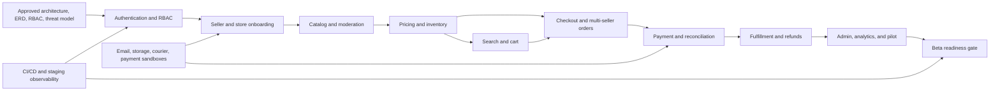

# MVP Roadmap

**Deliverable:** 4 — MVP Roadmap  
**Status:** Proposed; implementation begins only after all four initial design deliverables are approved  
**Planning unit:** Two-week sprint, one cross-functional delivery team

## 1. Outcome and planning assumptions

The MVP proves that a customer can safely complete a multi-seller technology purchase, each seller can fulfill only its portion, and administrators can govern the marketplace. It is a controlled beta, not the full long-term marketplace.

The plan assumes one stable team with approximately two frontend engineers, three Java engineers, one Python/data engineer, one QA/automation engineer, and shared product, UX, DevOps, and security support. A smaller or beginner-only team should reduce parallel work or extend the schedule; it should not remove transaction, authorization, or recovery testing.

The baseline is **16 two-week sprints (about 32 weeks)** from planning kickoff to beta decision: one approval sprint followed by 15 implementation and qualification sprints (about 30 weeks after Gate A). Sprint scope is capacity-based, not date-forced. External payment, email, object-storage, and courier sandbox access must be requested during Sprint 0; production-account onboarding begins early enough to complete before pilot qualification.

## 2. Scope and priority definitions

- **P0 — Core transaction path:** required for an internal end-to-end alpha. A P0 failure can expose data, money, inventory, or access controls.
- **P1 — Beta complete:** required before inviting external beta users. A P1 slice may start earlier only when its P0 dependencies are stable and it cannot displace critical-path safety work.
- **P2 — After beta:** valuable functionality intentionally deferred to Marketplace V1 or Growth/AI.

### Prioritized capabilities

| Priority | Capability | MVP outcome |
|---|---|---|
| P0 | Architecture, data model, security boundaries | Approved system, database, API, threat-model, and operational decisions |
| P0 | Authentication and RBAC | Customer and seller registration, login/logout, password hashing, email verification, refresh-token rotation, session revocation, user MFA enrollment/recovery with mandatory privileged-role MFA, lockout/device/login-risk controls, role/permission enforcement, audit trail |
| P0 | Customer, seller, staff, and store identity | Customer profiles; seller application and approval; store creation; scoped seller-staff permissions |
| P0 | Catalog, variants, pricing, media | Admin-owned taxonomy; moderated seller listings; variant/SKU price and media management |
| P0 | Transaction-safe inventory | Warehouse stock, adjustments, row-locked reservations, expiry, audit history, and overselling protection |
| P0 | Customer discovery | Responsive browse and product detail; approved-product OpenSearch indexing, filters, and basic autocomplete |
| P0 | Cart and checkout | Seller-grouped cart, server-side revalidation, address/shipping selection, idempotent checkout, and accurate totals |
| P0 | Multi-seller orders | One parent order, one order per seller, immutable item snapshots, independent status and shipment tracking |
| P0 | Payment and basic refund controls | Replaceable provider adapter, sandbox authorization/capture, signed/idempotent callbacks, failure recovery, reconciliation, admin-initiated full/partial refund |
| P0 | Seller fulfillment | Seller order queue, packing, shipment evidence, tracking number, cancellation rules, and seller-only data isolation |
| P0 | Administration and audit | Seller approval, product moderation, order/refund review, role-aware support access, immutable administrative audit events |
| P0 | Platform operations | CI/CD, secrets, structured logs, metrics, alerts, error tracking, encrypted backups, recurring restore drills, vulnerability scanning |
| P1 | Basic promotions | One seller/platform voucher model with eligibility, usage limits, and deterministic checkout calculation |
| P1 | Reviews | Verified-purchase review creation and basic moderation |
| P1 | Notifications | Transactional email for verification, order, payment, and shipment state changes with retry/dead-letter handling |
| P1 | Seller/admin summaries | Correct basic sales, order, low-stock, and marketplace metrics; no predictive claims |
| P1 | Python image processing | Validated asynchronous resize/compress pipeline with quarantined uploads and Java-approved metadata updates |
| P1 | Basic analytics | Read-only operational aggregates and reports with freshness labels |
| P1 | Usability and compliance | Mobile-responsive core journeys, accessibility validation, privacy controls, policies, and support runbooks |
| P2 | Advanced returns and disputes | Evidence workflow, inspection, replacement, arbitration, and status history |
| P2 | Automated seller payouts | Balance settlement, payout approval, provider execution, and tax statements |
| P2 | Advanced promotions and engagement | Flash sales, bundles, sponsored products, chat, alerts, comparison, and advanced vouchers |
| P2 | Expanded identity channels | Phone registration/SMS verification and social login after provider, privacy, account-linking, and recovery rules are approved |
| P2 | AI and growth | Recommendations, fraud scoring, ranking, forecasts, loyalty, wallet, referrals, mobile apps, and live selling |

P2 work does not enter an MVP sprint unless the beta gate is already satisfied and the change cannot destabilize the committed scope. Basic risk rules and manual payout reconciliation may be used during beta; they are not presented as the deferred automated systems.

## 3. Delivery phases and approval gates

```text
Architecture approval
        │
        ▼
Identity and RBAC
        │
        ▼
Seller + catalog + inventory
        │
        ▼
Cart + checkout + orders + payments
        │
        ▼
Fulfillment + admin + beta features
        │
        ▼
Hardening, pilot, and beta decision
```

| Phase | Sprints | Primary result | Exit gate |
|---|---:|---|---|
| 0. Architecture approval | 0 | All four initial deliverables approved and unresolved decisions assigned | **Gate A:** architecture, database design, project structure, roadmap, RBAC, critical workflows, threat model, API conventions, beta scope, data ownership, and retention/privacy/finance constraints signed off |
| 1. Secure foundation | 1–2 | Deployable skeleton plus production-grade authentication/RBAC | **Gate B:** identity security review and role-isolation suite pass |
| 2. Marketplace supply | 3–6 | Approved sellers can publish searchable, priced, in-stock variants | **Gate C:** seller isolation and inventory concurrency invariants pass |
| 3. Commerce transaction | 7–10 | A customer can pay for a multi-seller order and each seller can ship its portion | **Gate D:** checkout/payment failure drills and reconciliation pass |
| 4. Beta completeness | 11–12 | Governable marketplace with P1 communication, trust, analytics, and admin capability | Feature-complete staging release |
| 5. Hardening and beta | 13–15 | Measured quality, recovery evidence, stable pilot soak, operations handoff, and launch decision | **Gate E:** all beta criteria pass or have an explicitly accepted exception |

No implementation module begins before Gate A. After Gate A, authentication and authorization are the first product capability; catalog, order, payment, seller, or admin features may not bypass the identity foundation.

## 4. Sprint plan

The sprint outcomes below are vertical, demonstrable increments. Design, threat modeling, migration review, observability, and test automation are part of each item rather than separate cleanup work.

| Sprint | Goal and committed evidence | Depends on |
|---:|---|---|
| 0 | Approve all four initial deliverables, module/data ownership, RBAC matrix, multi-seller order and inventory state machines, API/error/idempotency conventions, threat model, environments, test strategy, beta scope, data classification, retention approach, and finance/privacy constraints. Record material choices as ADRs. No implementation or prototype code begins before Gate A. | Product, legal/privacy, finance, security, operations, and technical stakeholders |
| 1 | Establish repository checks, Docker Compose local runtime, Spring Boot/Spring Security/MySQL/Flyway baseline, and the first auth slice: customer and seller account registration, hashed credentials, login, deny-by-default security, and audit events. Enable structured logs, error tracking, baseline metrics, secret injection, and an encrypted scheduled-backup job. Demonstrate in CI and staging. | Gate A, secrets store, staging ownership |
| 2 | Complete email verification, refresh-token rotation/reuse detection, logout/revocation, password recovery, user MFA enrollment/recovery with enforcement for privileged roles, rate limiting/lockout, device/login history, suspicious-login alerts, role/permission administration, customer/seller/admin login screens, privacy-safe identity handling, and authorization matrix tests. Complete the first isolated restore exercise. | Email sandbox, Sprint 1 |
| 3 | Extend seller registration into the verification workflow: application details, document metadata/upload quarantine, admin approval/rejection, store profile, and seller-staff permission scoping. Prove seller A cannot see or change seller B. | Auth/RBAC, object-storage sandbox, approved KYC policy |
| 4 | Deliver categories, brands, products, variants, specifications, SKU uniqueness, media ordering, draft/approval/rejection, seller catalog screens, and admin moderation. | Seller/store ownership, taxonomy decisions |
| 5 | Deliver regular/sale price rules, warehouses, available/reserved stock, adjustments, reservation expiry, low-stock signals, and pessimistic-lock concurrency tests. | Product variants, inventory state machine |
| 6 | Deliver customer home/category/product pages, pagination and filters, OpenSearch approved-product projection, reindex tool, index-lag metrics, and initial asynchronous image resize/compress workflow. | Approved catalog, RabbitMQ/OpenSearch/object storage |
| 7 | Deliver persistent seller-grouped cart, quantity and stock/price revalidation, save-for-later, and the basic voucher rules engine with deterministic calculation tests. | Pricing, inventory, customer identity |
| 8 | Deliver address/shipping selection, quote expiry, idempotent checkout, row-locked reservations, parent/seller orders, immutable order-item snapshots, and rollback/retry tests. Establish the versioned beta workload profile and first production-like performance baseline. | Cart, inventory, order schema, shipping-rate contract, production-like staging capacity |
| 9 | Deliver replaceable payment adapter, sandbox authorization/capture, signed and idempotent callbacks, retry/cancellation, payment timeline, reconciliation job/report, provider-level idempotent refund primitive, and failure drills. | Checkout, payment sandbox and webhook access |
| 10 | Deliver customer order detail, seller order queue, packing/shipped status, seller shipment evidence, tracking events, basic cancellation, partial shipment support, initial seller-entitlement ledger entries, and transactional order/payment/shipping emails. Begin recruiting and onboarding the pilot cohort. | Orders, payment state machine, courier contract/email sandbox, approved pilot plan |
| 11 | Deliver essential admin/support/finance views, order and payment search, minimal return eligibility/intake, audited no-return and return-linked full/partial refunds, seller-ledger reversal effects, product/seller suspension, verified-purchase reviews, and moderation. Advanced return logistics, inspection, disputes, and replacements remain P2. | Orders/payments, RBAC, approved return/refund policy |
| 12 | Deliver seller/admin KPI and seller-balance summaries, manual payout hold/reconciliation/export controls, read-only analytics worker, notification retry/dead-letter operations, privacy-request controls, accessibility fixes, content/policy surfaces, and full P0/P1 regression. Complete production-provider/certificate readiness and freeze new beta scope at sprint end. | Stable transactional events, analytics definitions, finance controls, production integrations |
| 13 | Run end-to-end, concurrency, performance, security, dependency, accessibility, cross-browser/mobile, search-rebuild, observability, and backup/PITR restoration tests. Fix release-blocking findings, rehearse deployment/rollback, and freeze the release candidate before pilot traffic. | Feature-complete staging, production-like test environment |
| 14 | Onboard the pre-recruited controlled pilot cohort, execute acceptance scripts, and run a full seven-day soak on one unchanged release candidate while reconciling every pilot transaction. A release-changing fix resets the seven-day soak clock. | Frozen Sprint 13 candidate, support/on-call coverage, pilot agreements |
| 15 | Resolve pilot findings. If the release candidate changes, run a new complete seven-day soak; otherwise use the interval for operations handoff and readiness evidence. Hold Gate E only after the final unchanged candidate meets the soak and all beta criteria. | Sprint 14 evidence or replacement candidate, operations owners |

If a sprint misses a safety-critical outcome, dependent work may use mocks or contract tests but cannot be declared complete. The missed outcome returns to the top of the next sprint; the beta date moves if the critical path moves.

## 5. Dependency and critical-path map



### External and cross-team dependencies

| Dependency | Needed by | Latest safe date | Fallback without hiding risk |
|---|---|---:|---|
| Approval of all four initial deliverables | All implementation | End of Sprint 0 | Continue documentation, review, and decision work only; do not scaffold or prototype implementation |
| RBAC matrix and support/finance separation | Every protected API/UI | End of Sprint 0 | Deny unapproved actions by default |
| Seller verification and prohibited-product policy | Seller onboarding/moderation | Sprint 3 | Closed internal sellers only; no external onboarding |
| Payment provider sandbox, webhook keys, refund behavior | Checkout/payment | Sprint 7 | Continue adapter contract tests; beta cannot launch |
| Courier rate/tracking contract | Checkout/fulfillment | Sprint 7 | One manually configured beta shipping method, clearly documented |
| Email/SMS provider and sender verification | Identity/notifications | Sprint 1 for email | Email-only beta; defer phone registration and SMS until approved |
| Object storage and malware-scanning path | Seller documents/product media | Sprint 2 | Disable external uploads; use approved fixtures in non-production |
| Data ownership, classification, retention, privacy, and finance constraints | Schema and identity implementation | Gate A | Do not implement affected schemas or flows until accountable legal/privacy/finance owners approve the baseline |
| Detailed tax, terms, returns, and refund policy/copy | Checkout and beta policy | Sprint 7 | Restrict beta geography and payment methods; unresolved legal issues block launch |
| Production-like staging capacity | checkout baseline and hardening | Sprint 7 | Performance/recovery criteria remain unverified and dependent work cannot pass its gate |
| Production provider accounts, callback domains, DNS/TLS, sender identity, and deployment credentials | External pilot | Sprint 12 | Continue sandbox qualification only; external beta cannot start |
| Signed pilot agreements and recruited cohort | Pilot soak | Recruitment starts Sprint 10; ready by Sprint 13 | Delay pilot; do not shrink the cohort or soak duration to preserve a date |

## 6. Definition of ready and definition of done

### A capability is ready when

- Acceptance examples, non-goals, owner, and priority are agreed.
- Authorization, privacy classification, abuse cases, and audit needs are identified.
- Data ownership, migration approach, API/events, idempotency, and failure behavior are reviewed.
- External credentials or a faithful test double are available.
- Test data and measurable performance expectations are defined.

### A capability is done when

- Acceptance tests pass in a production-like environment.
- Unit, integration, contract, authorization, failure-path, and relevant end-to-end tests are automated.
- Migrations are forward-tested from the current release and from an empty database.
- Logs are structured and scrubbed; metrics, traces/correlation IDs, dashboards, and actionable alerts exist.
- Accessibility and responsive states cover loading, empty, validation, error, success, and retry behavior.
- API, business-rule, security, and operations documentation is current.
- There are no open Critical/High security findings or unresolved Sev-1/Sev-2 defects.
- A rollback or roll-forward procedure has been rehearsed for high-risk changes.

## 7. Testing milestones

Testing starts in Sprint 1 and expands with the product; it is not postponed to the hardening phase.

| Milestone | Sprint | Required evidence |
|---|---:|---|
| Identity security baseline | 2 | Customer/seller registration, password/verification/token tests; privileged MFA/recovery; rate-limit and lockout behavior; device/risk events; complete allow/deny RBAC matrix; cross-tenant denial; session revocation |
| Recurring recovery evidence | 2, 4, 6, 8, 10, 12, 14 | At least monthly: restore the latest encrypted backup in isolation, record timing/checksums, and run the financial/inventory checks available at that sprint; retain evidence and remediate failures immediately |
| Seller and catalog isolation | 4 | Seller ownership integration tests; admin-only moderation; file type/size/signature/quarantine tests; product validation and uniqueness |
| Inventory safety | 5 | Testcontainers row-lock tests, reservation expiry/release, retry/deadlock handling, adjustment audit, zero negative inventory under contention |
| Search projection integrity | 6 | Event schema/consumer idempotency tests; only approved products indexed; update/delete behavior; full rebuild parity and lag alert |
| Pricing/cart correctness | 7 | Boundary/time-zone/rounding tests; voucher eligibility and limit tests; server revalidation after price/stock changes |
| Multi-seller checkout | 8 | Parent/seller order split, immutable totals, partial failure rollback, duplicate submission, reservation recovery, and concurrent checkout tests |
| Payment reliability | 9 | Signed callback, replay, out-of-order event, timeout, retry, cancellation, duplicate capture and provider-refund primitive, and provider reconciliation tests |
| Fulfillment and refund control | 11 | State-transition authorization, partial shipment/evidence, cancellation and minimal-return eligibility, no-return/return-linked full and partial refund, seller-ledger effects, audit history, and seller/support/finance separation |
| System qualification | 13 | Complete critical E2E suite, performance/load report, DAST/SAST/dependency scan, accessibility/manual browser matrix, backup/PITR restore, search rebuild, deployment rollback |
| Pilot acceptance | 14–15 | Scripted customer/seller/admin/support journeys, full seven-day unchanged-candidate soak, transaction reconciliation, support rehearsal, operations handoff, stakeholder sign-off |

Every defect receives a regression test at the lowest useful layer. Automated non-production tests use provider sandboxes and synthetic data. The controlled pilot uses approved production integrations and its own least-privilege test/pilot accounts; production personal data is never copied into development or CI.

## 8. Risks and mitigations

| Risk | Probability / impact | Early warning | Mitigation and contingency |
|---|---|---|---|
| Scope expands toward a full Amazon-like platform | High / High | P2 stories enter committed sprints; carryover rises | Freeze P0/P1 at Sprint 0 and again at Sprint 12; require product/architecture approval for swaps; publish P2 backlog |
| Multi-seller order or inventory model is wrong | Medium / Critical | Frequent schema rewrites; flaky concurrency tests | Approve state machines and invariants before code; use row locks, idempotency, immutable snapshots, and focused Testcontainers load tests |
| Authorization leaks between sellers or privileged roles | Medium / Critical | UI-only checks; endpoints lack deny tests | Deny by default in Java, central permission vocabulary, resource-ownership checks, full role matrix, cross-tenant security tests, audit alerts |
| Payment integration or reconciliation is late | Medium / Critical | Sandbox/webhook access absent by Sprint 7 | Keep provider behind a port, build a deterministic simulator, request credentials in Sprint 0; payment evidence remains a beta blocker |
| Search diverges from MySQL | Medium / High | Index lag/backlog or result-count mismatch | Transactional outbox, idempotent consumers, dead-letter queue, lag/parity metrics, reindex and reconciliation runbooks |
| External uploads introduce malware or sensitive-data exposure | Medium / High | Files become public before scan; logs include URLs/tokens | Private quarantine bucket, allowlist and signature checks, size limits, malware scan, short-lived signed URLs, metadata auditing |
| Beginner team is overloaded by stack breadth | High / Medium | Long review cycles; ownership gaps; fragile deployments | One modular monolith, documented paved paths, pairing, small spikes, templates, WIP limits, and shared on-call rehearsal |
| Environment drift hides failures | Medium / High | Works locally but not staging; manual config edits | Versioned Compose/deployment config, immutable images, migration gates, environment parity checklist, automated smoke tests |
| Analytics/Python accidentally mutates source-of-truth data | Low / Critical | Python configured with application DB user | Read-only credentials and views, network/database grants, CI configuration check, events/Java APIs for proposed updates |
| Legal/tax/KYC/refund rules arrive late | Medium / High | Unresolved policy placeholders by Sprint 7 | Name accountable decision owners in Sprint 0; restrict beta geography/sellers/payments; unresolved mandatory policy blocks launch |
| Performance targets are discovered too late | Medium / High | No production-like baseline by Sprint 8 | Instrument from first slice, run query plans and focused load tests per feature, establish staged capacity model before full test |
| Backup exists but recovery fails | Medium / Critical | No restore owner or recent evidence | Automated encrypted backup, binary logs, isolated monthly restore, checksums and financial/inventory validation, Sprint 13 timed drill |
| Pilot cohort or stable soak is late | Medium / High | Recruitment incomplete at Sprint 12 or release candidate changes during soak | Recruit from Sprint 10, freeze the candidate before pilot, reset the full seven-day soak after a release-changing fix, and move Gate E rather than compress evidence |

The risk register is reviewed in every sprint review. Critical risks have a named owner, target date, and evidence link; accepting a residual Critical/High risk requires the Gate E decision group.

## 9. Measurable beta launch criteria

Gate E is evidence-based. The controlled beta launches only when every mandatory criterion passes or a time-bounded exception is approved by product, engineering, security, and the accountable business owner.

### Functional integrity

- 100% of critical-path automated scenarios pass on the release candidate: registration/verification/login, seller approval, product approval, stock setup, browse/search, cart, checkout, payment callback, multi-seller split, seller shipment, customer tracking, cancellation/refund, and audit review.
- All P0 and P1 acceptance criteria are complete; P2 functionality is hidden or explicitly unavailable.
- In a test with 100 simultaneous attempts to buy the final 10 units, exactly 10 units or fewer are committed, stock never becomes negative, no reservation is duplicated, and the test passes 20 consecutive runs.
- Replaying checkout, payment, refund, and shipment idempotency keys produces no duplicate order, capture, refund, inventory movement, or state transition.
- Every pilot payment, refund, order total, inventory movement, and seller balance summary reconciles to its source records with zero unexplained variance.

### Security and privacy

- The complete guest/customer/seller/seller-staff/admin/support/finance/content-manager allow-and-deny matrix passes, including cross-seller resource tests.
- Independent threat-model review is complete; automated secret, dependency, container, SAST, and DAST scans report zero open Critical or High findings.
- Passwords use the approved adaptive hash; refresh-token reuse revokes the token family; verification/reset tokens expire and are single-use; privileged actions are audited.
- No raw card data, secrets, verification tokens, unnecessary personal data, or private file URLs appear in database fixtures, source control, client bundles, or sampled logs.
- MySQL is not publicly reachable, and application, migration, read-only analytics, and backup identities pass a least-privilege review.

### Reliability, performance, and recovery

- Over a seven-day staging soak with scheduled synthetic journeys, checkout availability is at least 99.9%, payment workflow success excluding intentional provider declines is at least 99.9%, and there are no unreconciled transactions.
- Under the beta qualification profile—100 concurrent virtual users for 60 minutes, sustaining at least 30 search requests/second, 10 cart mutations/second, and 3 checkout submissions/second, plus one 10-minute burst at twice those rates—p95 search response is under 1 second, p95 add-to-cart is under 500 milliseconds, and p95 standard MySQL query time is under 200 milliseconds with zero financial, inventory, or authorization errors.
- The customer homepage achieves p75 LCP under 2.5 seconds across at least 30 cold-cache runs using a mid-tier Android profile with four-times CPU slowdown, 9 Mbps downstream bandwidth, and 150 ms round-trip latency. Test tooling and page fixtures are versioned with the release evidence.
- OpenSearch projection lag is below 60 seconds for 99% of approved product changes; rebuilding and validating 100,000 approved variants from MySQL completes within two hours and yields no unexplained parity difference. Larger launch catalogs require a proportionally tested objective before Gate E.
- A fresh backup plus binary logs is restored into an isolated environment within a provisional 4-hour RTO and 15-minute RPO. Financial totals, inventory, object references, and migration checksums pass the restore checklist.
- Deployment, database migration, application rollback/roll-forward, RabbitMQ dead-letter recovery, and OpenSearch rebuild runbooks are rehearsed by someone other than their author.
- Production callback domains, TLS/DNS, sender identity, provider credentials, least-privilege secrets, and deployment identities pass provider certification or a controlled low-value production smoke test. Sandbox-only evidence cannot authorize an external beta.

### Quality and user readiness

- There are zero unresolved Sev-1 or Sev-2 defects. Sev-3 defects have an owner, workaround, and target release; no Sev-3 may affect money, inventory, authorization, privacy, or the critical path.
- Critical business modules—authentication/RBAC, inventory, checkout/orders, payments, and refunds—meet at least 90% branch coverage, while the repository meets at least 80%; coverage exclusions are reviewed and mutation or invariant tests cover critical rules.
- Playwright critical journeys pass on the current and previous major versions of Chrome, Edge, Firefox, and Safari, plus the agreed iOS Safari and Android Chrome viewports.
- Core customer, seller, and administrator journeys meet WCAG 2.2 AA: automated scans have zero serious/critical violations and manual keyboard, focus, screen-reader, zoom, error, and contrast checks pass.
- The pre-recruited cohort includes at least 10 pilot sellers, each publishing five approved variants, and at least 30 pilot customers completing the scripted journeys. At least 90% complete each critical task without staff intervention; every failure is triaged before go/no-go.
- Support coverage, escalation contacts, status communication, privacy/marketplace/refund policies, seller onboarding material, monitoring dashboards, actionable alerts, and on-call runbooks are published and acknowledged by their owners.

## 10. Release governance

- Sprint reviews demonstrate working behavior and evidence; percent-complete estimates do not satisfy a gate.
- Architecture, security, database, and contract changes receive the appropriate owner review and an ADR when they alter a material decision.
- Release candidates are built once, promoted unchanged through environments, and identified by source revision, image digest, schema version, and contract version.
- Feature flags default off for unfinished or risky capabilities and must have an owner and removal date.
- Gate E may decide **go**, **conditional go** with explicit constraints, or **no-go**. A conditional go cannot waive a Critical security, financial, inventory, data-loss, or recovery criterion.

After a stable beta, the team uses observed support volume, conversion, search quality, seller operations, reconciliation effort, and incidents to reprioritize Marketplace V1. Deferred advanced returns/disputes, automated payouts, recommendations, and fraud scoring begin only after their business rules and data quality are approved.
